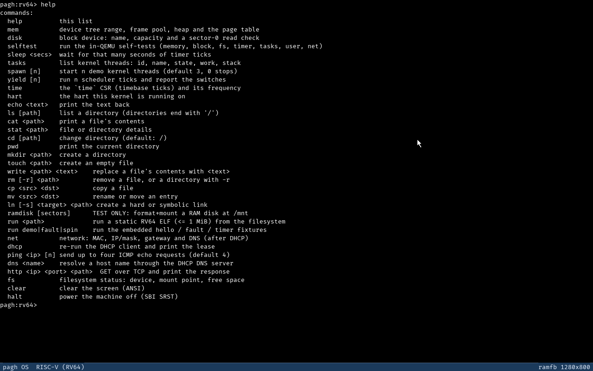
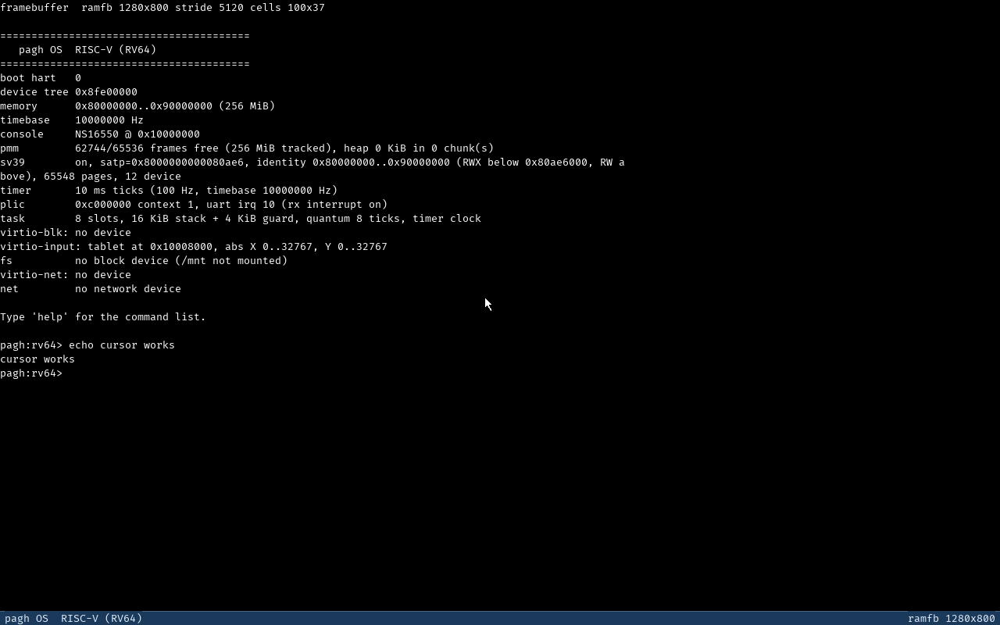
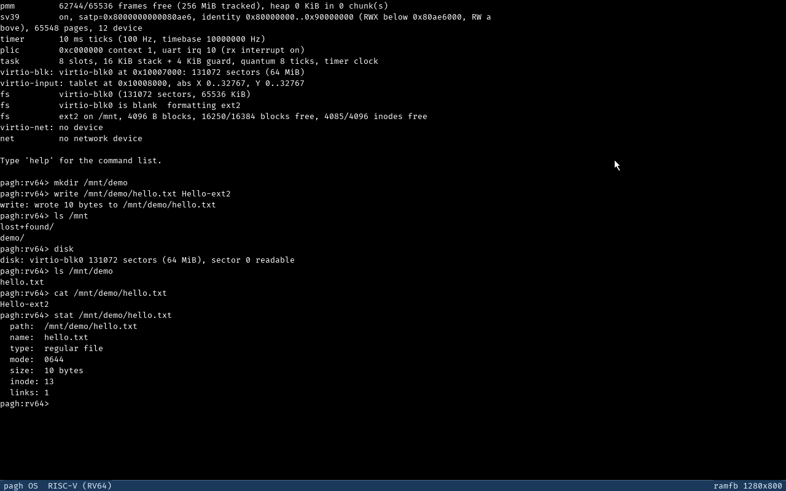
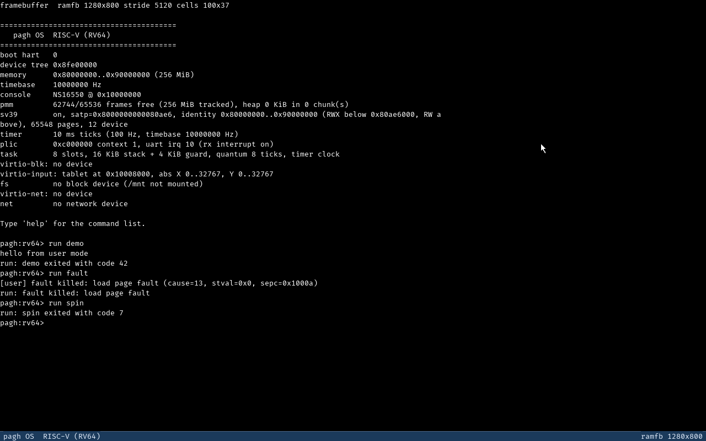
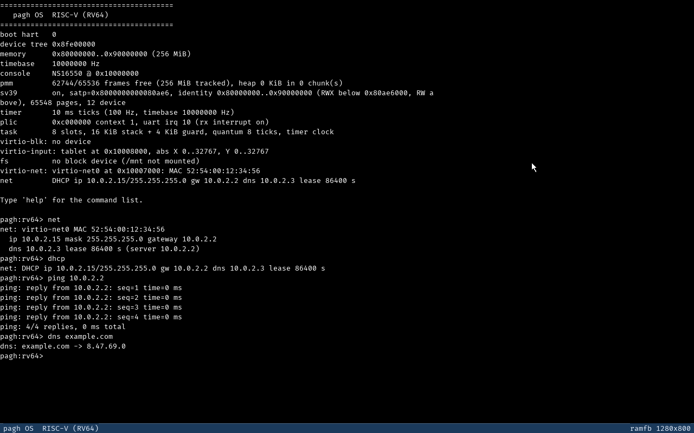
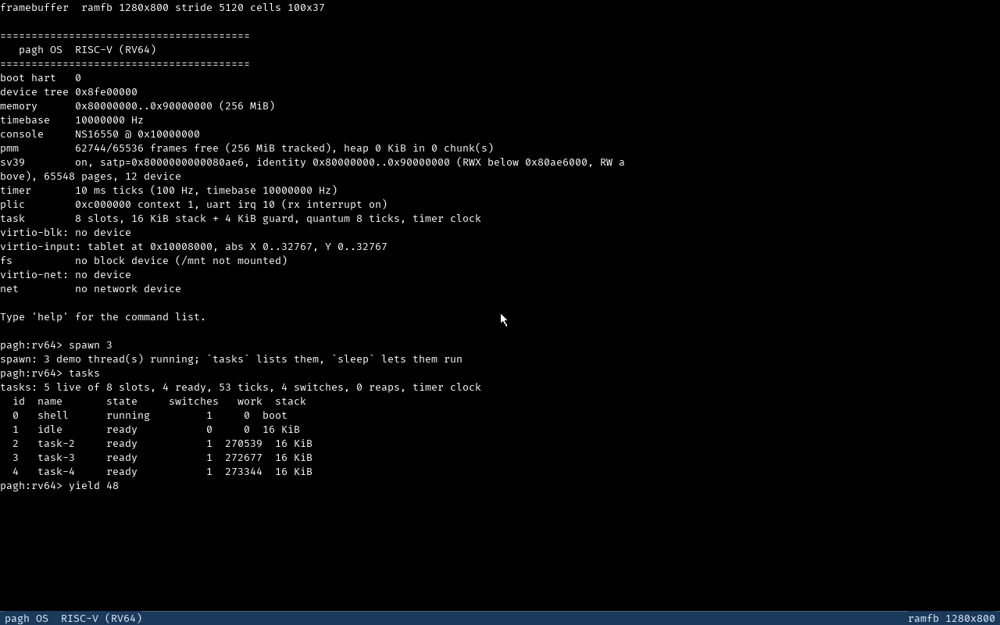

<h1 align="center">pagh-riscv</h1>

<p align="center">
  Небольшое 64-битное ядро для RISC-V (RV64) на Rust: <code>#![no_std]</code>,
  без единой внешней зависимости, загрузка через OpenSBI, запуск в QEMU.
</p>

<p align="center">
  
  
  
  
  
  
</p>

---

## English summary

`pagh-riscv` is the 64-bit RISC-V port of the [pagh](https://github.com/ccclosed/Pagh-OS)
kernel: a small `#![no_std]` Rust kernel that boots under OpenSBI on QEMU's `virt`
machine, reads the machine description from the flattened device tree, allocates
physical frames from a bitmap pool, serves `alloc` from a kernel heap that grows in
64 KiB chunks, brings up a ramfb screen with an 8×18 coverage font next to the serial
console, installs a trap vector that names its cause instead of resetting silently,
and drops into an interactive serial shell with an in-kernel self-test. On top of
that it has a 100 Hz timer, a PLIC-driven UART, a virtio-mmio disk with ext2/VFS,
preemptive kernel threads, a virtio-net NIC with its own TCP/IP stack (DHCP, DNS,
ICMP, a minimal TCP client) and — since M6b — **user mode**: a static ELF runs with
the `U` bit set, enters through `sret`, talks to the kernel through an `ecall`
ABI and is killed (not the machine) when it faults. **All of these are verified on
a live boot**; what is genuinely missing — per-process page tables, a journal,
SMP, TLS/apt — is listed plainly in [Чего нет](#чего-нет). The documentation is deliberately checkable: every claim in
[`docs/architecture.md`](docs/architecture.md) cites the file and line it comes from,
and the CI smoke test asserts the exact boot log this README shows.

```sh
cargo build                              # riscv64gc-unknown-none-elf, pinned nightly
./run.sh                                 # QEMU-окно при наличии дисплея, иначе serial; Ctrl-A X — выход
DISK=/tmp/pagh.img ./run.sh              # + virtio-диск: пустой образ будет отформатирован и смонтирован в /mnt
NO_MOUSE=1 ./run.sh                      # без virtio-tablet: путь «указателя нет»
python3 tools/run.py --keys "help\n" --shot /tmp/shot.png --check-font   # screen + font
python3 tools/run.py --mouse 900 300 --shot /tmp/cursor.png             # + software-курсор в (900,300)
```

Docs: [architecture](docs/architecture.md) · [roadmap](docs/roadmap.md) ·
[screenshots](docs/screenshot.md) · [contributing](CONTRIBUTING.md) ·
[agents](AGENTS.md) · [crate map](src/README.md).

---

## Скриншот



Указатель M8: `virtio-input` tablet на virtio-mmio, курсор — software-слой в
теневом буфере. Позиция ниже задана командой
`python3 tools/run.py --mouse 900 300 --shot …`: стрелка стоит ровно в
запрошенном пикселе, а текст под ней печатается обычным образом (курсор
перерисовывается поверх кадра, не «замораживая» клетку).



Диск M5: virtio-mmio-устройство найдено через DTB, пустой образ отформатирован,
ext2 смонтирован в `/mnt`; `ls`/`cat`/`stat` работают, `disk` показывает ёмкость и
живую проверку сектора 0.



Планировщик M6a: `spawn 3` завёл три потока, `tasks` показывает снимок таблицы
(id, имя, состояние, переключения, счётчик работы, стек), `yield 48` прогнал тики
и переключения; `idle` держит hart в `wfi`, счётчики демо-потоков растут и без
единого `yield`, потому что тик таймера вытесняет их из trap-контекста.

User mode M6b: `run demo` исполняет статический ELF в U-mode (`write`,
`sched_yield`, `exit(42)`), `run fault` намеренно падает по load page fault —
ядро печатает причину и **оставляет машину живой**, `run spin` крутится в U-mode
0.2 с, чтобы таймер успел вытеснить задачу, и выходит с кодом 7. Native ABI для
libpagh: `run <path> [args...]` передаёт `argc`/`argv`/`envp`, а `read`/`openat`/
`fstat`/`getdents64`/`brk`/`clock_gettime`/`uname`/`readlinkat` проверены
встроенным `userland/abi.elf` в `selftest`.

Native sockets (BSD subset): `socket(AF_INET, SOCK_STREAM)` → `connect` по
IPv4-литералу → `send`/`recv` → `shutdown`/`close`; `read`/`write` на сокете
идут теми же путями. Это ровно один клиент поверх уже существующего TCP-стека:
без `listen`/`accept`, UDP, DNS и TLS. Живой прогон —
`python3 tools/test_sockets.py` (HTTP-сервер на хосте, `http_get` и ABI-фикстура
в QEMU); транскрипт — `docs/live-sockets.txt`.



Сеть M7: `net` показывает MAC и DHCP-lease, `ping 10.0.2.2` проходит через
собственный ARP/ICMP-путь, `dns example.com` разрешает имя через DNS из lease, а
`http` открывает TCP-соединение собственным клиентом.





Это не макет и не рендер на хосте: кадр нарисован самим ядром в теневом буфере и
отдан устройству `ramfb`, а снят из работающего QEMU через `screendump`. Команда
воспроизведения — та же, что проверяет пиксели:

```sh
python3 tools/run.py --keys "help\n" --shot docs/shell.png --check-font --scan-all
```

`--check-font` сверяет каждый символ на экране с `assets/font8x18.bin` (ассет
шрифта 8×18) и падает на одном отличающемся пикселе; в этом снимке проверены все
6880 клеток — ни одна не содержит пикселей вне ассета. Внизу — статус-бар
(`pagh OS  RISC-V (RV64)` … `ramfb 1280x800`).

Серийный лог одного прогона smoke-драйвера в режиме `--ramfb` (сокращён только лог
OpenSBI перед первой строкой ядра). Те же строки в том же порядке проверяет CI:

```text
framebuffer  ramfb 1280x800 stride 5120 cells 100x37

========================================
   pagh OS — RISC-V (RV64)
========================================
boot hart   0
device tree 0x8fe00000
memory      0x80000000..0x90000000 (256 MiB)
timebase    10000000 Hz
console     NS16550 @ 0x10000000
pmm         62934/65536 frames free (256 MiB tracked), heap 0 KiB in 0 chunk(s)

Type 'help' for the command list.

pagh:rv64> mem
memory 0x80000000..0x90000000 (256 MiB)
pmm    62802 free of 65536 frames (256 MiB), pool 0x80000000..0x90000000
heap   0 B used, 0 B mapped from the pool in 0 chunk(s) of 64 KiB
sv39   on  satp=0x8000000000080a28, root 0x80a28000, identity 0x80000000..0x90000000 (RWX below 0x80a28000, RW above), 65537 pages, 1 device
pagh:rv64> hart
hart 0
pagh:rv64> time
time 3950155 ticks (~0 s at 10000000 Hz)
pagh:rv64> echo smoke ok
smoke ok
pagh:rv64> nosuchcmd
nosuchcmd: unknown command (try 'help')
pagh:rv64> run demo alpha beta
hello from user mode
run: demo exited with code 42
pagh:rv64> help
commands:
  help          this list
  mem           device tree range, frame pool, heap and the page table
  selftest      run the in-QEMU memory self-tests
  time          the `time` CSR (timebase ticks) and its frequency
  hart          the hart this kernel is running on
  echo <text>   print the text back
  clear         clear the screen (ANSI)
  halt          power the machine off (SBI SRST)
pagh:rv64> halt
halt: powering off
```

Проверки памяти запускаются из шелла (`selftest`) и печатают вердикт построчно —
это фрагмент другого прогона, той же сборки:

```text
pagh:rv64> selftest
[selftest] free frames before: 62802 of 65536
SELFTEST frames-roundtrip PASS
SELFTEST frame-pattern PASS
SELFTEST sv39-map-roundtrip PASS
SELFTEST sv39-translate PASS
[selftest] heap: 8256 B in use, 65536 B mapped, 1 chunk(s)
SELFTEST heap-vec PASS
heap: double free of 0x80a73090 ignored
heap: refusing to free 0x802302b8: not a heap block
SELFTEST heap-defenses PASS
SELFTEST SUMMARY: 7/7 passed
[selftest] PMM hygiene: free frames 62802 -> 62802
```

Числа кадров зависят от размера ядра и от `-m`; проверяется не они, а то, что
строка есть, что все проверки PASS и что ledger до и после совпадает.

---

## Что работает сегодня

Статус — по коду в дереве, а не по замыслу. «Готово» подтверждено живым запуском.

| Подсистема | Статус | Что именно есть | Где |
|---|---|---|---|
| Загрузка | готово | `_start` ставит стек и вызывает `kmain(a0, a1)`; OpenSBI запускает ровно один hart (id не обязательно 0), остальные держит остановленными | `src/arch/riscv64/boot.rs` |
| Модель привилегий | готово | S-mode под OpenSBI, M-mode не трогаем; U-mode для user-программ через `sret` (`SPP=0`), выключение через SBI SRST | `src/arch/riscv64/{sbi,traps}.rs`, `src/user/mod.rs` |
| Device tree | готово | пять вопросов: `/memory`, `timebase-frequency`, окна `virtio,mmio`, PLIC `reg`, UART `interrupts`; ошибка разбора фатальна | `src/fdt.rs` |
| Ловушки | готово | `stvec` → `trap_entry` (обмен `sscratch` различает U/S), диспетчер: прерывания возвращаются, исключение из S-mode печатает и паркует hart, исключение из U-mode завершает только задачу | `src/arch/riscv64/traps.rs`, `src/user/mod.rs` |
| Консоль | готово | NS16550 по `0x1000_0000`, 8N1; приём — по прерыванию PLIC в кольцевой буфер (polled-путь остаётся запасным), передача по-прежнему polled; один текстовый поток — два стока | `src/drivers/uart.rs`, `src/console.rs` |
| Экран | готово | ramfb 1280×800, stride 5120, сетка 100×37, шрифт покрытия 8×18, статус-бар; кадр отдаётся на каждый `kprint!`; software-курсор — часть кадра (см. строку «Мышь») | `src/drivers/{fw_cfg,ramfb,framebuffer}.rs` |
| Мышь, клавиатура и курсор (M8) | готово | virtio-input на том же virtio-mmio: **tablet** (абсолютные оси, диапазон из `CFG_ABS_INFO`) или mouse как fallback, и **keyboard** (US-раскладка, shift/caps/backspace/enter/tab) — оба устройства QEMU `virt` выставляет отдельными virtio-mmio-узлами с одним device id, драйвер различает их по битовым картам возможностей. Курсор 12×19 — часть кадра; клавиатурные байты шелл читает из idle-цикла рядом с UART, поэтому окно QEMU становится полноценной консолью. Опроса из idle-цикла достаточно (100 Гц); своего прерывания у устройств нет | `src/drivers/virtio_input.rs`, `src/drivers/framebuffer.rs` |
| Шелл | готово | редактор строки (строки длиннее 128 байт отклоняются целиком, а не обрезаются), idle-цикл на 100 Гц, в котором опрашиваются UART-кольцо, сеть, указатель и клавиатура; одна и та же консоль работает и через serial, и через окно QEMU; команды памяти/диска/ФС/сети, `run <path>`, `run demo` / `run fault` / `run spin`, `sleep`, `time`, `halt` (полный список — в таблице ниже) | `src/shell.rs`, `src/user/mod.rs`, `src/net/`, `src/drivers/virtio_input.rs` |
| Физическая память (PMM) | готово | битовая карта 4 KiB-кадров окна 8 GiB (покрывает QEMU `virt` с RAM выше 4 GiB), `set = свободен`, выделение одиночное и непрерывным блоком | `src/memory/pmm.rs` |
| Куча ядра, `alloc` | готово | `#[global_allocator]` поверх PMM-кадров: чанки по 64 KiB, free-list, целиком свободный чанк возвращается в PMM; `Vec` проверен `selftest` | `src/memory/{heap,selftest}.rs` |
| Страницы (Sv39) | готово | identity-карта 4 KiB-страниц, `satp` включён: `[RAM base, __kernel_end)` RWX, выше — RW **без X**, страницы устройств RW без U; таблицы берутся из PMM, пустые возвращаются при `unmap`. User-страницы живут в этой же карте с `U=1`; отдельного `satp` на процесс нет | `src/memory/paging.rs`, `src/arch/riscv64/mmu.rs`, `src/user/elf.rs` |
| Таймер | готово | тик 100 Гц через SBI TIME: абсолютный дедлайн (+10 мс на прерывание, без накопления дрейфа), `sie.STIE`, `sleep`/`uptime` в тиках; холостой цикл — `wfi` | `src/arch/riscv64/timer.rs` |
| Прерывания / PLIC | готово | PLIC из DTB (`riscv,plic0`), контекст S-mode, UART source из DTB (10 на QEMU `virt`), claim/complete, счётчики и `overrun`; диспетчер различает timer/external и возвращается через `sret` | `src/arch/riscv64/plic.rs`, `src/arch/riscv64/traps.rs` |
| Блочное устройство | готово | virtio-mmio (modern virtio 1.x, version 2), polled: окна транспорта находятся через DTB, read/write/flush, опрос завершения с ограничением и FAILED после таймаута; `-global virtio-mmio.force-legacy=false` обязателен (иначе QEMU даёт legacy-транспорт) | `src/drivers/block.rs`, `src/drivers/virtio_mmio.rs` |
| Файловая система (ext2) | готово | чтение/запись файлов (direct + single/double indirect), truncate, каталоги, create/unlink/mkdir/rmdir/rename, симлинки; совместимо с образом хостового `mkfs.ext2 -t ext2`; форматируется только пустое устройство (MBR/GPT/чужие данные — отказ с причиной); журнала/WAL нет | `src/fs/ext2/`, `src/fs/format_policy.rs` |
| VFS | готово | `VfsNode`, синтетический корень, монтирование в `/mnt`, два примитива разрешения путей (`lookup_path` без последней симлинки / `walk` с переходом и бюджетом) | `src/vfs/mod.rs` |
| Планировщик, потоки ядра (M6a) | готово | контекстный switch (callee-saved ABI), до 16 слотов (14 user-потоков на процесс), round-robin, квант 8 тиков, стек 16 KiB + guard из PMM, состояния `Ready/Running/Blocked/Stopped/Exited`, `block_current`/`wake_task` с тиковым дедлайном, `stop_current`/`continue_task` для job control, `Task::satp` + `install_satp` перед switch, вытеснение тиком таймера из trap-контекста (включая вытеснение U-mode), `tasks`/`spawn`/`yield`; exit возвращает кадры | `src/arch/riscv64/switch.rs`, `src/task/` |
| User mode, syscalls, ELF, native ABI (M6b) | готово | `sret` в U-mode (`SPP=0`, `SPIE=1`, `SUM=0`, `sscratch`-контракт); нативные потоки `clone`/`gettid`/`set_tid_address`/`exit`/`exit_group`/`futex` (общие Process/root, fd-таблица, heap и mmap; своё ядро-стек и user-стек вызывающего), фьютексы `WAIT`/`WAKE`; процессы `fork`(1000)/`execve`(221)/`wait4`(260)/`getppid`(173): свой Sv39-root/ASID, глубокая копия страниц, наследование fd/pipe/обработчиков, замена образа и статус `wait`, очистка сирот раннером; вход `a0=argc`, `a1=argv`, SysV-кадр `argc/argv/envp` с `argv[0]` как набран и `PWD=<cwd>`; `ecall`-диспетчер: `read`/`write`/`openat`/`close`/`lseek`/`fstat`/`getdents64`/`brk`/`clock_gettime`/`nanosleep`/`uname`/`readlinkat`/`exit`/`sched_yield`/`getpid` + `mkdirat`/`unlinkat`/`symlinkat`/`linkat`/`renameat2`/`fchmodat`/`ftruncate` (мутации через `parent_and_leaf` + `walk(parent, true)`, per-process режим для `fstat`), `sepc+4`, таблица 16 fd на процесс, `copy_from_user`/`copy_to_user` с проверкой `U/R/W` и `SUM` вокруг копии, heap-окно 1 MiB с возвратом кадров; ELF64-загрузчик с откатом кадров и **потоковым чтением** `ImageSource` (сегменты кусками ≤ 512 B, без буфера размером с файл), `run <path> [args...]` до 1 MiB и фикстуры `demo`/`fault`/`spin`/`argv`/`abi`; BSD-сокеты `socket`/`connect`/`sendto`/`recvfrom`/`setsockopt`/`getsockopt`/`shutdown` (один TCP-клиент, IPv4-литералы) и маршрутизация `read`/`write`/`close` на сокет; POSIX-подобные сигналы `kill`/`tgkill`/`rt_sigaction`/`rt_sigprocmask`/`rt_sigreturn`/`sigaltstack` (обработчики на процесс: fork копирует, exec сбрасывает; pending/blocked/altstack на поток; user-кадр 736 B с полным `siginfo_t` и `ucontext_t`; `SA_SIGINFO`/`SA_ONSTACK`/`SA_NODEFER`/`SA_RESETHAND`/`SA_RESTART`; job control `SIGSTOP`/`SIGTSTP`/`SIGTTIN`/`SIGTTOU` + `SIGCONT`); synchronous SIGSEGV/SIGILL/SIGBUS/SIGTRAP при установленном обработчике; fault из U без обработчика убивает процесс; таймер вытесняет U-mode | `src/user/`, `src/user/process.rs`, `src/user/signal.rs`, `src/memory/paging.rs`, `userland/` |
| Сеть (M7) | готово | virtio-net (modern, polled) + свой стек: Ethernet/ARP/IPv4/ICMP/UDP/TCP, DHCP-клиент, DNS-резолвер, `net`/`dhcp`/`ping`/`dns`/`http`; без smoltcp и внешних крейтов. Для userland — один active-open TCP-сокет (`AF_INET`/`SOCK_STREAM`, IPv4-литерал), syscall'ы которого сами опрашивают NIC; `read`/`write` работают на сокете | `src/net/`, `src/drivers/virtio_net.rs`, `src/user/syscall.rs` |
| Пакеты (`pkg`) | MVP | нативный установщик (не apt): плоский `index` и `.ppkg` с репозитория по **plain HTTP** (`http://IP:port/`, в QEMU хост — `10.0.2.2`), потоковая загрузка в `/mnt/pkg` кусками 4 KiB, шлюз «размер + SHA-256 из индекса» **до** разбора `PPKG0001`; `kind=app` → `/mnt/bin/<name>`, `applet-bundle` → `/mnt/bin/paghbox` + симлинки; манифест в `/mnt/pkg/<name>.manifest`; TLS/OpenPGP/apt по-прежнему нет | `src/pkg/` |
| apt / TLS / OpenPGP | **нет** | apt намеренно не подключён, пока нет vendored TLS + проверки подписей Debian; `pkg` — отдельный нативный путь для портов | — |
| Тесты | готово | host-тестов нет; in-QEMU `selftest` — 7 памяти + 4 блока/указателя + 11 ext2/VFS + 4 прерываний/таймера + 5 планировщика + 10 user-mode (ABI-фикстуры `argv`/`abi` с секциями потоков/фьютексов и сигналов — обработчик, restorer, `rt_sigreturn`, pending/blocked, SIG_IGN, EINTR на futex, synchronous SIGSEGV, негативные коды; 10/10 с диском, 8/10 + 2 SKIP без `/mnt`) + 11 сети (идемпотентность по ledger'у), QEMU-smoke в шести режимах (serial, ramfb, диск-fresh, диск-existing, net, keyboard), установка пакета проверяется отдельным тестом `pkg`, живой сокетный прогон — `tools/test_sockets.py` (не в CI); проверка пикселей `tools/font_check.py` | `src/*/selftest.rs`, `src/net/selftest.rs`, `src/pkg/`, `.github/smoke.py`, `tools/` |
| CI | готово | `fmt`, debug/release build, QEMU-smoke в шести режимах: serial, ramfb, диск-fresh (формат/монтирование/запись), диск-existing (повторная загрузка читает файл), net (DHCP + ping шлюза), keyboard (virtio-keyboard печатает `help`/`halt` через монитор QEMU); во всех приложен virtio-tablet, в keyboard — ещё и virtio-keyboard | `.github/workflows/ci.yml` |

---

## Быстрый старт

```sh
rustup target add riscv64gc-unknown-none-elf   # nightly запинен в rust-toolchain.toml
cargo build                                    # debug-ядро, линкуется linker.ld
./run.sh                                       # QEMU virt + OpenSBI: окно и serial-консоль одновременно
```

`run.sh` — канонический способ запуска (Linux/QEMU). Он собирает ядро и выполняет
по сути это:

```sh
qemu-system-riscv64 -machine virt -m 256M -device ramfb \
                    -kernel target/riscv64gc-unknown-none-elf/debug/pagh \
                    -display none -serial mon:stdio -no-reboot
```

`-device ramfb` — это и есть экран: у машины `virt` нет VGA, а ядро находит
устройство через `fw_cfg`. По умолчанию поверхность рисуется **off-screen**
(`-display none`), поэтому `screendump` и `tools/run.py` работают без графической
сессии. `./run.sh` при наличии дисплея (`DISPLAY`/`WAYLAND_DISPLAY`) открывает
окно QEMU с заголовком `pagh-riscv`, а `--headless` оставляет только serial;
`run.sh` подключает
и клавиатуру (`-device virtio-keyboard-device`): у `virt` нет PS/2, поэтому ввод
из окна идёт как virtio-input и попадает в тот же шелл, что и serial — можно
пользоваться любым из двух. Если запустить QEMU без `-device ramfb`, ядро остаётся
serial-консолью и честно печатает
`framebuffer  ramfb: no such fw_cfg item — serial console only`.

Сеть включена по умолчанию: `run.sh` добавляет `-netdev user -device
virtio-net-device`, ядро получает `10.0.2.15/24` по DHCP, шлюз `10.0.2.2`
(он же loopback хоста, поэтому `http 10.0.2.2 <port>` достучится до слушателя на
хосте) и DNS `10.0.2.3`. `NO_NET=1 ./run.sh` — машина без сетевой карты, путь
«NIC отсутствует» тоже проверяется smoke-тестом.

| Аргумент / переменная | По умолчанию | Смысл |
|---|---|---|
| `--window` | авто: включено при наличии дисплея | показать экран окном QEMU (`-display gtk`) |
| `--headless` | авто: выключено при наличии дисплея | serial-only: рисовать off-screen |
| `PROFILE` | `debug` | `release` — собрать и запустить release-ядро |
| `MEMORY` | `256M` | объём RAM у `virt` |
| `BIOS` | — (QEMU `-bios default`) | внешняя прошивка, например `BIOS=/path/opensbi.bin` |
| `DISK` | — | образ virtio-mmio диска; отсутствующий создаётся пустым (64 MiB), пустой форматируется ядром и монтируется в `/mnt` |
| `NO_NET` | `0` | `1` — не подключать virtio-net (проверка отсутствия NIC и старых сценариев) |
| `NO_MOUSE` | `0` | `1` — не подключать virtio-tablet (проверка отсутствия указателя: курсора нет, всё остальное работает) |

Выход из QEMU — `Ctrl-A`, затем `X`. Изнутри гостя: команда `halt` (SBI SRST,
машина действительно выключается, QEMU завершается с кодом 0).

Автоматические проверки «ядро живо» — те же, что в CI:

```sh
cargo build
python3 .github/smoke.py target/riscv64gc-unknown-none-elf/debug/pagh           # только serial
python3 .github/smoke.py target/riscv64gc-unknown-none-elf/debug/pagh --ramfb   # + экран
python3 tools/run.py --keys "help\n" --shot /tmp/shot.png --check-font          # пиксели против ассета
```

M6b вживую (те же команды понимает шелл):

```sh
# после prompt'а pagh:rv64>
run demo        # hello from user mode + run: demo exited with code 42
run demo a b    # то же: у фикстуры по контракту argc=1, лишние слова не мешают
run fault       # [user] fault killed: load page fault ... ; шелл жив
run spin        # 0.2 s в U-mode (таймер вытесняет) -> exit 7
selftest        # + SELFTEST user-*: 10/10 с /mnt (без диска 8/10 + 2 SKIP)
```

### Native ABI для libpagh

`run <path> [args...]` входит в U-mode по контракту
`pagh-api/docs/abi.md`: `a0 = argc`, `a1 = argv`, `sp` выровнен на 16 байт и
указывает на SysV-кадр `[argc][argv0..][NULL][env0..][NULL][строки]`.
`argv[0]` — путь **как набран** в шелле, окружение — `PWD=<cwd>`; `envp`
программа восстанавливает из `sp` (`argv + argc + 1`), отдельного регистра под
него нет. Аргументы после пути делятся по пробелам: кавычек и экранирования в
шелле нет, поэтому аргумент с пробелом передать нельзя. У встроенных фикстур
`argc = 1` (`argv = [demo]`), лишние слова после `run demo` игнорируются.

| nr | вызов | семантика |
|---:|---|---|
| 63 | `read` | fd 0 — консоль: UART-кольцо, затем virtio-клавиатура, иначе `-EAGAIN` (ядро **никогда не блокирует**); файл — с offset; каталог — `-EISDIR` |
| 64 | `write` | fd 1/2 — консоль; файл — по offset, `O_APPEND` пишет в конец; fd 0 — `-EBADF` |
| 56 | `openat` | `dirfd` игнорируется, путь только абсолютный; `O_RDONLY/WRONLY/RDWR`, `O_CREAT`, `O_TRUNC`, `O_APPEND`; `mode` принимается и **игнорируется** (в VFS нет `set_mode`, ext2 даёт 0o644) |
| 57 | `close` | освобождает дескриптор; 0/1/2 тоже можно закрыть — до конца прогона |
| 62 | `lseek` | SET/CUR/END, знаковый 64-битный offset; консоль и каталог — `-EINVAL` |
| 80 | `fstat` | нативный `Stat` (24 B): режим, тип, размер, ino из `VfsNode`; синтетические узлы — 0o755/0o644 |
| 61 | `getdents64` | снимок детей каталога на `openat`, записи `Dirent` (12 B заголовок + имя, выравнивание 8); курсор двигается только за скопированные записи |
| 214 | `brk` | окно 1 MiB по фиксированному адресу (см. ниже); `brk(0)` — текущий break; возвращаемое значение всегда выровнено вверх на страницу, рост/сжатие постранично, за окном — `-ENOMEM` |
| 113 | `clock_gettime` | id 0/1 — тиковое время ядра (`Timespec`, разрешение 10 ms), другие id — `-EINVAL` |
| 101 | `nanosleep` | `Timespec` проверяется и округляется **вверх** до тика; `rem` игнорируется; ждёт в `wfi` с разрешёнными прерываниями |
| 160 | `uname` | 5×16 байт: `pagh`, `pagh-riscv`, `0.10.0`, версия пакета, `riscv64` |
| 78 | `readlinkat` | цель символической ссылки без NUL; не ссылка — `-EINVAL` |
| 172 | `getpid` | id процесса (`Process.pid`), один на все его потоки; у процесса из шелла положительный, pid 0 зарезервирован |
| 173 | `getppid` | pid родителя: у программы, запущенной шеллом, — 0; у `fork`-ребёнка — pid родителя; после `execve` сохраняется |
| 178 | `gettid` | id вызывающего потока (уникален в прогоне) |
| 96 | `set_tid_address` | принимается и игнорируется; возвращает tid вызывающего |
| 124 | `sched_yield` | добровольное переключение |
| 93 | `exit` | завершает **вызывающий поток**; если он последний — прогон кончается, `run_source` возвращает код главного потока (код не-главного отбрасывается); не возвращается |
| 94 | `exit_group` | завершает все потоки прогона (готовые и заблокированные) и возвращает код главного, если он уже вышел, иначе код вызывающего; не возвращается |
| 220 | `clone` | нативный `clone(flags, stack, entry, arg)`: `CLONE_VM|CLONE_THREAD` обязательны, `CLONE_FS/FILES/SIGHAND` принимаются (общие и так), `CLONE_SETTLS` — `-ENOTSUP`, неизвестный бит — `-EINVAL`; дочерний поток стартует в U-mode на `entry(arg)` со `sp=stack` и не возвращается из syscall (и `entry` не должен возвращаться — трамплина нет); родитель получает tid (>0). `clone(0,0,0,0)` — алиас `fork` |
| 1000 | `fork` | pagh-native (в asm-generic номера нет): глубокая копия user-страниц (image, heap, mmap, 64 KiB стек) в новый root/ASID, копия fd-таблицы (pipe — +1 ссылка на ring, сокет — `-ENOTSUP` в ребёнке), копия обработчиков/blocked/altstack, без pending и чужих потоков; ребёнок получает 0, родитель — pid, обе стороны продолжают с `sepc+4`; ошибки `-EAGAIN`/`-EINVAL` |
| 221 | `execve` | абсолютный путь, `argv`/`envp` через `copy_from_user`; новый root, ELF, 64 KiB стек и SysV-кадр; старые image/heap/mmap/стек освобождаются, `pid`/`ppid`/fd/blocked-маска сохраняются, все обработчики → `SIG_DFL`, alt-стек выключен, pending погашен, sibling-потоки сняты; `a0=argc`, `a1=argv`, `sepc` не сдвигается; ошибки `-ENOENT`/`-ENOEXEC`/`-EISDIR`/`-E2BIG`/`-EFAULT`/`-ENOMEM` не меняют образ |
| 260 | `wait4` | `pid > 0` — конкретный ребёнок, `0`/`-1` — любой, `pid < -1` — `-EINVAL`; `options & !WNOHANG` — `-EINVAL`; возвращает pid зомби, 0 при `WNOHANG`, `-ECHILD`, `-EFAULT`; статус — `code << 8` либо номер сигнала в младших 7 битах; блокирует вызывающий поток и просыпается на exit/exit_group/fault ребёнка; `SIGCHLD` не генерируется |
| 98 | `futex` | `uaddr, op, val, timeout, uaddr2, val3`: `FUTEX_WAIT` (0) проверяет `*uaddr == val` и блокирует до `FUTEX_WAKE`/тикового дедлайна; `FUTEX_WAKE` (1) будит не больше `val`; `FUTEX_PRIVATE_FLAG` принимается; `WAKE_OP`/requeue/PI — `-ENOSYS`; `-EAGAIN`/`-ETIMEDOUT`/`-ENOMEM`, как в POSIX |
| 129 | `kill` | `pid > 0` — tid потока прогона, `0`/`-1` — все живые потоки; `sig = 0` — только проверка существования; неизвестный pid — `-ESRCH`, signum вне 0..31 — `-EINVAL`; SIGSTOP/SIGTSTP/SIGTTIN/SIGTTOU с `SIG_DFL` останавливают поток (per-thread `Stopped` в планировщике), SIGCONT возобновляет; signal помечается pending, а заблокированный `FUTEX_WAIT` будится (wait вернёт `-EINTR`, либо перезапустится при `SA_RESTART`) |
| 131 | `tgkill` | `tgid` обязан совпадать с `getpid()`, `tid` — живой поток прогона; иначе `-ESRCH`; доставка как у `kill`, `si_code = SI_TKILL` |
| 132 | `sigaltstack` | `*SigAltStack { ss_sp, ss_flags, pad, ss_size }` (24 B), `*oldstack`; `SS_DISABLE=2` выключает, `SS_ONSTACK=1` репортится на активном стеке; размер ≥ `MINSIGSTKSZ = 4096`, весь диапазон `U|R|W`, иначе `-EINVAL`/`-EFAULT`; стек per-thread |
| 134 | `rt_sigaction` | `struct sigaction { handler, flags, mask, restorer }` (32 B), `sigsetsize = 8`; `SIG_DFL=0`, `SIG_IGN=1`; для функции обязательны `SA_RESTORER=0x04000000` и restorer в user-exec странице; допустимы `SA_ONSTACK=0x08000000`, `SA_RESTART=0x10000000`, `SA_NODEFER=0x40000000`, `SA_RESETHAND=0x80000000`, `SA_SIGINFO=4`; другие биты — `-EINVAL`; SIGKILL/SIGSTOP — `-EINVAL`; таблица 1..31 на процесс (fork копирует, exec сбрасывает) |
| 135 | `rt_sigprocmask` | `how` 0/1/2 (`SIG_BLOCK`/`SIG_UNBLOCK`/`SIG_SETMASK`), маска 8 B, сигнал `n` — бит `n-1`; маска per-thread; биты SIGKILL/SIGSTOP отбрасываются; `oldset` пишется до установки новой маски; `sigsetsize != 8` — `-EINVAL` |
| 139 | `rt_sigreturn` | вызывается restorer'ом при `sp` на кадр сигнала; проверяет `U|R` весь кадр (736 B), magic, signum, frame flags и активный кадр потока, восстанавливает `TrapFrame` (`sepc/sp/regs`), blocked-маску, глубину alt-стека и `sstatus` (`SPP=0`, `SUM=0`, `SPIE=1`); без кадра/чужой кадр — `-EINVAL`, плохой указатель — `-EFAULT`; `sepc` не сдвигается (при `SA_RESTART` `sepc` остаётся на `ecall` и syscall повторяется) |
| 34 | `mkdirat` | создать каталог; `dirfd` игнорируется, `mode` принимается и **игнорируется** (в VFS нет `set_mode`, ext2 даёт 0o755) |
| 35 | `unlinkat` | `flags = 0` — удалить файл или ссылку (каталог — `-EISDIR`); `0x200` (`AT_REMOVEDIR`) — пустой каталог (не пустой — `-ENOTEMPTY`, файл — `-ENOTDIR`) |
| 36 | `symlinkat` | создать ссылку: `a0` — цель (сырая строка, **не** резолвится), `a1` — `dirfd` (игнорируется), `a2` — путь |
| 37 | `linkat` | жёсткая ссылка; оба `dirfd` игнорируются, `flags` обязан быть 0; каталог — `-EISDIR` |
| 276 | `renameat2` | переименование/перенос одной транзакцией VFS; `flags` обязан быть 0; межмонтовый перенос — `-ENOTSUP` |
| 53 | `fchmodat` | `mode & 0o7777` пишется в per-process таблицу по `fs_ino`; `fstat` видит новые биты до конца процесса, на диск не пишется; синтетический узел — `-ENOTSUP`; ребёнок после `fork` таблицу не наследует |
| 46 | `ftruncate` | изменить размер открытого regular-файла; fd 0/1/2 — `-EINVAL`, каталог — `-EISDIR`, read-only fd — `-EBADF` |
| 23 | `dup` | копия дескриптора в первый свободный слот; файл/каталог/pipe делят объект (pipe — ещё одна ссылка на ring); нет слота — `-ENOSPC`, плохой fd — `-EBADF` |
| 24 | `dup2` | копия в `newfd`, старый occupant закрывается; `flags = 0`, `newfd >= 16` — `-EBADF`, `oldfd == newfd` — возврат без изменений; `dup3`-семантики (`-EINVAL` при равенстве) нет |
| 59 | `pipe2` | `fds` — два `i32`; ring 4 KiB, read/write концы; `flags` обязан быть 0 (`O_NONBLOCK` уже единственный режим, `O_CLOEXEC` не реализован); ошибка не оставляет ни fd, ни ring; pipe наследуется `fork` с +1 ссылкой |
| 7 | `poll` | `pollfd[16]`, `timeout_ms`: 0 — один неблокирующий скан, <0 — без дедлайна; `POLLIN/POLLOUT/POLLERR/POLLHUP/POLLNVAL`; сам опрашивает UART/клавиатуру/NIC; для сокета — `net::poll` |
| 72 | `ppoll` | `Timespec` округляется вверх до мс, `NULL` — навсегда; `sigmask`/`sigsetsize` принимаются и игнорируются; остальное как `poll` |
| 222 | `mmap` | только `MAP_PRIVATE|MAP_ANONYMOUS`, `fd = -1`, `offset = 0`; `PROT_READ|WRITE|EXEC`, W^X (W и X вместе — `-EINVAL`), `PROT_NONE` — `-EINVAL`; `addr` — подсказка, окно `USER_MMAP_BASE..TOP`; кадры выделяются и обнуляются сразу, ошибка откатывает всё; предел 256 страниц/регионов 8 |
| 215 | `munmap` | только страницы, созданные `mmap` этого процесса; `addr` выровнен, `length > 0`; частичный unmap делит регион; чужая страница/дырка — `-EINVAL` |
| 226 | `mprotect` | `PROT_*` как у `mmap`; все страницы диапазона обязаны быть живыми user-leaf (`U|R`) до первой записи PTE; W^X; смена прав сохраняет кадр и делает `fence.i` |
| 198 | `socket` | только `AF_INET` (2), `SOCK_STREAM` (1), protocol 0; иначе `-EAFNOSUPPORT`; fd ≥ 3, второе соединение при открытом первом — `-ENOSPC` |
| 203 | `connect` | `a1` — 16-байтный `sockaddr_in` (family u16 LE, port u16 BE, addr[4], padding), `a2 = 16`; указатель и family валидируются, ошибки — `-EFAULT`/`-EINVAL`/`-EAFNOSUPPORT`/`-ENETUNREACH`/`-EHOSTUNREACH`/`-ECONNREFUSED`/`-ETIMEDOUT`; внутри опрашивает NIC до готовности handshake |
| 206 | `sendto` | `send` на connected-сокете: `flags = 0`, `dest` опционален (валидируется и игнорируется); TCP-send синхронный (ждёт ACK с ограниченным опросом), ошибки — `-ENOTCONN`/`-EPIPE`/`-ECONNRESET`/`-ETIMEDOUT` |
| 207 | `recvfrom` | `recv` на connected-сокете: `flags = 0`, `src/src_len` опциональны (заполняются адресом peer'а); **неблокирующий**: `-EAGAIN` — повторить, 0 — peer закрылся |
| 208 | `setsockopt` | `SO_REUSEADDR`/`SO_KEEPALIVE`/`SO_RCVTIMEO`/`SO_SNDTIMEO`/`TCP_NODELAY` принимаются и игнорируются (границы ядра фиксированы), остальное — `-ENOPROTOOPT` |
| 209 | `getsockopt` | `SO_TYPE` → `SOCK_STREAM`, `SO_ERROR` → 0, таймауты → 0, `TCP_NODELAY` → 0; остальное — `-ENOPROTOOPT` |
| 210 | `shutdown` | `how` 0/1/2 валидируется, но half-close нет: закрываются оба направления, fd остаётся открытым (последующий `read` → 0, `write` → `-EPIPE`) до `close` |

Пределы и отличия, которые важно знать userland'у: 16 дескрипторов **на
процесс** включая 0/1/2 (кончились — `-ENOSPC`); путь ≤ 256 байт с NUL;
`argv`+`env` ≤ 64 строк и ≤ 16 KiB; heap — ровно 1 MiB в
`0x2000_0000..0x2010_0000`, кадры под него возвращаются в PMM после процесса
(включая fault). Процессов — до 6 (`MAX_PROCESSES`), потоков — до 14 на процесс
(главный + 13 `clone`; 16 слотов планировщика минус `shell` и `idle`); у каждого
потока свой kernel-стек 16 KiB + guard из PMM, user-стек передаёт вызывающий и
ядро его не освобождает; futex-таблица — 32 ожидающих на 16 адресов; TLS/PI/
requeue и `join`/`waitid` нет. Сигналы — узкое POSIX-подмножество: 31 номер, один pending-бит
на сигнал и один кадр 736 B на активный обработчик (вложенность допустима),
per-thread alt-стек через `sigaltstack`/`SA_ONSTACK`, полный 128-байтный
`siginfo_t` (`si_pid`/`si_uid`/`si_code`/`si_addr`/`si_status`) и 288-байтный
`ucontext_t` с GPR/PC/SP и маской для `SA_SIGINFO`. `SA_NODEFER`/`SA_RESETHAND`
реализованы; `SA_RESTART` перезапускает только `futex`/`nanosleep` и с полным
таймаутом заново. Job control — только остановка потоков: SIGSTOP/SIGTSTP/
SIGTTIN/SIGTTOU паркуют поток в планировщике, SIGCONT возвращает его в очередь;
tty и process-group модели нет, поэтому остановить весь процесс
`kill(0, SIGSTOP)` можно, а возобновить извне — некому. SIGKILL/SIGSTOP нельзя поймать или
заблокировать; `sigqueue`, `sival_ptr`, очередей сигналов и SIGFPE-генератора
нет.
**Процессы (native-proc).** `fork(1000)` — pagh-native номер (asm-generic его
не имеет), `clone(0,0,0,0)` — алиас; `execve(221)`, `wait4(260)` и `getppid(173)`
— обычные номера. У процесса свой Sv39-root и ненулевой 16-битный ASID:
`paging::create_user_space` копирует в него все supervisor-отображения ядра, а
user-страницы добавляет только этот процесс. Поэтому два процесса не видят
память друг друга, но ядро и устройства доступны из любого root'а; `satp`
переключается в `scheduler::install_satp` перед `task_switch`, и, хотя ASID —
метка TLB, смена root всегда сопровождается полным `sfence.vma` (кадр таблицы
может быть переиспользован). `fork` — **глубокая копия**, не COW: image, heap,
mmap и 64 KiB user-стека копируются постранично; fd-строка копируется (pipe
получает +1 ссылку на общий ring, сокет в ребёнке становится `-ENOTSUP`, offset
файла копируется, а не делится); обработчики, blocked-маска и altstack
наследуются, pending-биты — нет. Ребёнок возвращается с `a0 = 0`, родитель — с
pid; обе стороны продолжают с `sepc + 4`.

`execve` собирает ELF, стек и SysV-кадр в новом root'е и подменяет образ
атомарно: старые image/heap/mmap/стек освобождаются, `pid`/`ppid`/fd и
blocked-маска сохраняются, все обработчики сбрасываются в `SIG_DFL` (даже
`SIG_IGN` — отличие от POSIX), alt-стек выключается, pending гасится,
sibling-потоки снимаются. На успехе `dispatch` не пишет `a0` и не двигает
`sepc`: кадр уже указывает на `entry` с `a0=argc`, `a1=argv`. Ошибка не меняет
старый образ.

`wait4` возвращает pid зомби, `0` при `WNOHANG`, `-ECHILD` или `-EINVAL`;
статус — `code << 8` для обычного выхода либо номер сигнала в младших 7 битах
(core-бита нет). `SIGCHLD` **не генерируется**: родителя будит прямой
`notify_parent` из `exit`/`exit_group`/`on_fault`, а `siginfo.si_status` для
явно посланного SIGCHLD остаётся 0. Init-процесса нет, поэтому сироту (ребёнка,
пережившего foreground-`run`, или внука после `wait4` его родителя) раннер
убивает и хоронит `cleanup_orphans`: `kill_group` → `force_finish` → `reap` →
освобождение fd/сигналов/страниц. Приглашение шелла возвращается только когда
таблица процессов и PMM-ledger пусты.

Мутации каталога (`mkdirat`/`unlinkat`/`symlinkat`/`linkat`/`renameat2`/`fchmodat`)
идут через `parent_and_leaf` + `walk(parent, true)` и одну VFS-транзакцию:
ошибка не оставляет полусостояния, а неудачный `openat(O_CREAT)` (кончились fd)
удаляет только что созданный файл. `chmod` **не сохраняется**: режим живёт в
таблице прогона и виден только `fstat` этого процесса — на диск и на права он
не влияет (в VFS нет `set_mode`); `mkdirat`/`openat` игнорируют `mode` по той же
причине.
`getdents64` при буфере меньше одной записи возвращает 0 — как конец каталога;
буфер на 264 байта покрывает самое длинное имя ext2. Неизвестный номер —
`-ENOSYS`; плохой указатель — `-EFAULT`, а не page fault.

Сокетный ABI — один active-open TCP-клиент: второй `socket()` при открытом
первом — `-ENOSPC`, `connect` принимает только IPv4-литерал (DNS-вызова нет),
`recv` неблокирующий, `shutdown` закрывает оба направления. `connect`/`send`/
`close` включают прерывания на время ожидания (как `nanosleep`), чтобы тики
шли и дедлайн работал, и крутят `net::poll()` — иначе NIC некому опрашивать,
пока исполняется user-программа. `listen`/`accept`, UDP, IPv6, `sendmsg`/
`recvmsg`, `poll`/`select` и TLS отсутствуют и отвечают `-ENOSYS`. Программа,
вышедшая с открытым сокетом, закрывает его при teardown прогона.

Сигналы (129/131/132/134/135/139) — нативные, не Linux-совместимые по
структурам: `struct sigaction` — это `handler, flags, mask, restorer`, а
`sigaltstack` — `{ ss_sp, ss_flags, pad, ss_size }`. Обработчики и `SIG_IGN`
живут в таблице прогона (сбрасывается вместе с ним), pending-биты,
blocked-маски, alt-стек и указатель на активный кадр — у каждого потока.
Доставка происходит на границе kernel→user: конец syscall'а или конец любого
trap'а из U-mode (включая тик), поэтому работающий поток получает сигнал не
позже чем через тик, а заблокированный в `futex` — сразу после `wake_task` (его
wait возвращает `-EINTR`, затем обработчик; при `SA_RESTART` — перезапускается).
`nanosleep` проверяет pending каждый тик и тоже возвращает `-EINTR` (или
перезапускается). Заблокированный сигнал остаётся pending.

Кадр сигнала (736 B, 16-выровнен) кладётся ниже текущего `sp` — или ниже верха
alt-стека при `SA_ONSTACK`: сохранённый `TrapFrame` (264 B), blocked-маска,
magic, restorer, `siginfo_t` (128 B), указатель на предыдущий кадр, signum,
`ucontext_t` (288 B) и frame flags (бит «переключились на alt-стек»).
`siginfo_t`: signo/errno/code (0..12), затем `si_pid`/`si_uid` либо `si_addr`
(16..24), `si_status` (24..28); `ucontext_t`: flags/link/`uc_sigmask` (0..24),
`mcontext` = `gregs[32]` (x0..x31) + `pc` (24..288). `SA_SIGINFO` даёт
`handler(signo, *siginfo, *ucontext)`; без него — нативный
`handler(signo, *siginfo)`. Каждая страница проверяется `U|R|W` до записи,
плохой `sp` — это смерть прогона (`bad signal stack` / `bad alternate signal
stack`), а не kernel fault. Обработчик входит с `ra=restorer`, `sp=кадр`;
restorer делает `ecall 139`, который восстанавливает прерванную инструкцию,
маску и глубину alt-стека. `SA_NODEFER` не блокирует доставленный сигнал,
`SA_RESETHAND` сбрасывает disposition в `SIG_DFL` при входе.

`SIG_DFL` для SIGTERM/SIGINT/SIGQUIT/SIGABRT/SIGSEGV/SIGILL/SIGFPE/SIGBUS/SIGKILL
и остальных «фатальных» завершает прогон (один процесс — один run),
SIGCHLD/SIGCONT/SIGURG/SIGWINCH игнорируются. SIGSTOP/SIGTSTP/SIGTTIN/SIGTTOU с
`SIG_DFL` паркуют целевой поток (`State::Stopped`, не планируется, стек и
signal-состояние сохраняются); SIGCONT чистит pending-stop и возвращает его в
ready-очередь. `kill(0/-1)` адресует все потоки прогона, поэтому так можно
остановить весь run; tty/process-group модели нет, и возобновить его извне
некому — это документированный предел. SIGKILL/SIGSTOP нельзя поймать или
заблокировать. Синхронный SIGSEGV/SIGILL/SIGBUS/SIGTRAP при установленном
обработчике доставляется вместо убийства прогона (`si_addr` = `stval`,
`si_code` = `SEGV_MAPERR`/`SI_KERNEL`/`BUS_ADRALN`/`TRAP_BRKPT`); без
обработчика сохраняется прежнее поведение `user::on_fault`.

### Как управлять шеллом

Промпт `pagh:rv64> `, строка до 128 байт (более длинная отвергается целиком),
backspace работает, всё остальное — команды:

| Команда | Что делает |
|---|---|
| `help` | список команд |
| `mem` | память из device tree **и** статистика PMM и кучи (свободно/всего кадров, диапазон пула, байты кучи) |
| `selftest` | in-QEMU self-tests: 7 памяти, 4 блока/указателя, 11 ext2/VFS, 4 таймера/PLIC, 5 планировщика, 10 user-mode (включая мутационную половину ABI-фикстуры, сокетную секцию и секцию потоков: `clone`/`gettid`/futex/`exit`/`exit_group`; с живым сервером на `10.0.2.2:8000` — connect/send/recv/shutdown/EOF, без него — `SKIP`; без `/mnt` два SKIP — `user-run-large-file` и `user-abi-syscalls`, итог 8/10); печатает ledger свободных кадров до и после каждого блока |
| `disk` | блочное устройство: имя, ёмкость, живая проверка чтения сектора 0 |
| `ls [path]` | листинг каталога (каталоги с `/`) |
| `cat <path>` | содержимое файла |
| `stat <path>` | путь, имя, тип, режим, размер, inode, ссылки |
| `cd [path]` / `pwd` | текущий каталог (лексическое склеивание, без `..` из монтирования) |
| `mkdir <path>` / `touch <path>` | создать каталог / пустой файл |
| `write <path> <text>` | заменить содержимое файла текстом |
| `rm [-r] <path>` | удалить файл, каталог — с `-r` |
| `cp <src> <dst>` / `mv <src> <dst>` | копировать / переименовать |
| `ln [-s] <target> <path>` | жёсткая или символическая ссылка |
| `ramdisk [sectors]` | **только для тестов**: отформатировать RAM-диск и смонтировать его в `/mnt` |
| `run <path> [args...]` | исполнить статический RV64 ELF из VFS в U-mode: файл читается **потоково** (ELF-заголовок, program headers и сегменты кусками ≤ 512 B), без буфера размером с файл; `args` уходят в `argv[1..]`, `argv[0]` — путь как набран; образ ≤ 1 MiB, один user-образ за раз |
| `run demo` / `run fault` / `run spin` | встроенные фикстуры: hello (exit 42), падение по load page fault (задача убита, машина жива), 0.2 s спина в U-mode (exit 7); `argc = 1`, лишние слова игнорируются |
| `net` | MAC, `ip/mask`, gateway, DNS и срок DHCP-lease |
| `dhcp` | повторить DHCP-обмен (DISCOVER/OFFER/REQUEST/ACK) и напечатать новый lease |
| `ping <ip> [n]` | до 4 ICMP echo через свой ARP/IPv4/ICMP-путь; печатает `seq`, время и итог |
| `dns <name>` | A-запись через DNS-сервер из lease |
| `http <ip> <port> <path>` | HTTP/1.0 GET через TCP-клиент; ответ печатается в консоль |
| `pkg repo [URL]` / `pkg index` / `pkg list` | показать/задать репозиторий (по умолчанию `http://10.0.2.2:8000/`), скачать и разобрать индекс, показать пакеты с `[installed]` |
| `pkg install <name>` / `pkg remove <name>` / `pkg installed` | скачать, проверить размер+SHA-256, установить в `/mnt/bin`; удалить по манифесту; список установленного |
| `time` | два счётчика: CSR `time` (аппаратный) и тики ядра; uptime, число прерываний таймера, статистика PLIC/UART |
| `hart` | id hart'а, на котором работает ядро |
| `echo <text>` | печатает текст (слова через один пробел) |
| `clear` | очистка экрана ANSI-последовательностью (чистит и экран, и терминал) |
| `sleep <secs>` | ждать столько секунд тиков (`wfi`, не спин) |
| `tasks` | потоки ядра: id, имя, состояние, переключения, работа, стек |
| `spawn [n]` | запустить n демо-потоков (по умолчанию 3; 0 — остановить) |
| `yield [n]` | прогнать n тиков планировщика и показать число переключений |
| `halt` | выключение машины через SBI SRST |

Истории, автодополнения и стрелок нет — это следующий уровень шелла, а не
забытая деталь.

### Пакеты: `pkg` (нативный установщик)

`pkg` ставит в `/mnt` один статический RV64 ELF из `.ppkg`, скачанного с
плоского HTTP-репозитория. Это **не apt**: ни Debian-метаданных, ни `.deb`, ни
solver'а зависимостей, ни сжатия, ни OpenPGP; TLS тоже нет. Репозиторий — это
файл `index` и каталог `pkg/*.ppkg`; формат описан в `docs/package-format.md`
репозитория [`pagh-programs`](https://github.com/ccclosed/pagh-programs).

```sh
# на хосте (в pagh-repo): зеркало для QEMU user network
./serve.sh                                   # python3 -m http.server 8000 -d .

# в госте, после prompt'а pagh:rv64>
pkg repo http://10.0.2.2:8000/               # 10.0.2.2 — loopback хоста
pkg index                                    # pkg: index 1 package(s)
pkg list                                     # hello 1.0.0 13555 B
pkg install hello                            # pkg: installed hello 1.0.0
run /mnt/bin/hello                           # hello from user mode / exited with code 42
pkg installed                                # pkg: hello 1.0.0
pkg remove hello                             # pkg: removed hello
```

**Шлюз — размер и SHA-256.** Пакет пишется в `/mnt/pkg/<name>.ppkg` потоково,
кусками 4 KiB, и те же байты считаются в SHA-256. Пока счётчик и дайджест не
совпали с индексом, в `/mnt/bin` не создаётся ничего; при несовпадении
скачанный файл удаляется. Только после шлюза читаются `PPKG0001`, длины и
манифест, а payload копируется в `/mnt/bin/<name>` (для `applet-bundle` —
`paghbox` плюс симлинки из `commands`). Манифест `/mnt/pkg/<name>.manifest`
пишется последним, и `pkg remove` работает по нему.

Это проверка **целостности**, а не подписи: зеркало, которое отдаёт другой
пакет с тем же размером и хешем, дизайном не ловится. HTTPS и OpenPGP — следующий
майлстоун; до него `pkg` честно говорит «only plain http:// is supported
(there is no TLS yet)» на `https://` и не притворяется apt.

Ограничения MVP: до 64 пакетов в индексе, IPv4-хост в URL (без DNS), один
пакет за раз, `payload ≤ 8 MiB`, до 160 команд в `applet-bundle`, `/mnt`
обязателен. `pkg` без аргументов
печатает usage; `pkg selftest` проверяет SHA-256 по векторам FIPS.

Полный E2E (сборка `.ppkg` из `userland/hello.elf`, HTTP-сервер, QEMU с
диском, включая отказ испорченному пакету):

```sh
python3 tools/test_pkg.py
```

---

## Архитектура

Подробно, с ссылками на файлы и строки — [`docs/architecture.md`](docs/architecture.md).
Здесь — короткая версия.

**Путь загрузки.** OpenSBI (M-mode) передаёт управление в S-mode на `_start` с
`a0` = hart id и `a1` = адрес DTB, без стека и с выключенными прерываниями.
Дальше фазы идут строго по порядку, каждая опирается на предыдущую:

| # | Фаза | Код |
|---|---|---|
| 1 | `_start`: OpenSBI запускает ровно один hart (любого id); стек и `kmain` | `src/arch/riscv64/boot.rs` |
| 2 | стек: `sp = __stack_top`, 64 KiB в `.bss`, выравнивание 16 | `src/arch/riscv64/boot.rs` |
| 3 | захват hart id в `BOOT_HART_ID` (пока он в `a0`) | `src/arch/riscv64/boot.rs` |
| 4 | `call kmain(a0, a1)` | `src/arch/riscv64/boot.rs` |
| 5 | консоль: `uart::init()` + попытка поднять экран (`console::init` → `framebuffer::init`) | `src/main.rs`, `src/console.rs` |
| 6 | баннер: hart, адрес DTB | `src/main.rs` |
| 7 | разбор DTB; ошибка → печать и остановка, без угадывания | `src/main.rs`, `src/fdt.rs` |
| 8 | память и timebase из DTB — в лог | `src/main.rs` |
| 9 | PMM: пул кадров по `/memory` минус образ ядра, стек и блоб DTB | `src/main.rs`, `src/memory/` |
| 10 | `traps::init()`: `stvec` + `sstatus.SIE` — до всего, что может сбойнуть | `src/main.rs`, `src/arch/riscv64/traps.rs` |
| 11 | `shell::run(tree)` — цикл консоли, не возвращается | `src/main.rs`, `src/shell.rs` |

**Привилегии.** Ядро живёт в S-mode; M-mode принадлежит прошивке, и обращаться
туда можно только через SBI (`ecall`) — именно так работает `halt`. M-mode CSR
из S-mode недоступны физически: `csrr …, mhartid` — это illegal instruction, и
ядро узнало это на своём опыте (см. `docs/architecture.md`, раздел 2). `satp`
включает Sv39 с identity-картой (страницы 4 KiB, без user-бита); U-mode нет.

**Устройства.** Единственное описание машины — device tree: ядро читает из него
память и частоту timebase, отказываясь угадывать при ошибке разбора. Адреса UART
и `fw_cfg` продублированы константами только потому, что консоль нужна раньше
разбора (у обоих в коде написано, почему, и оба падают громко, а не молча).

**Сеть.** `virtio_net` — тот же modern virtio-mmio (две очереди, polled), а над
ним свой стек: `wire.rs` знает байты и контрольные суммы, `mod.rs` — ARP-кэш,
IPv4, ICMP и UDP, а `dhcp`/`dns`/`tcp` — маленькие клиенты. Всё синхронно:
`net::poll()` вызывается из сетевых команд и idle-цикла шелла, а ожидание —
опрос до дедлайна в тиках, поэтому сеть не требует ни потока, ни прерывания.
Детали и честные границы — [`src/net/README.md`](src/net/README.md).

**Память.** Ядро линкуется на `0x8020_0000` (`linker.ld`), `.bss` — 8 МиБ:
две поверхности экрана (тень и scanout), битовая карта PMM, стек 64 KiB и
статики; `__kernel_end` выровнен на 4 KiB. `.bss` не обнуляется кодом ядра:
обнуляет ELF-загрузчик QEMU (NOBITS-сегмент) — и это существенно, потому что
полярность карты PMM («бит установлен = кадр свободен») держится именно на нулях.
Полная карта — в `docs/architecture.md`, раздел 6.

**Ловушки.** `trap_entry` сохраняет 33 регистра в кадр на 264 байта; смещения —
это ABI, они совпадают с порядком `sd` в ассемблере. Исключение печатает
`[EXC] <имя> (scause=…, stval=…, sepc=…)` и останавливает hart; прерывание
возвращается через `sret`. Паники в обработчике нет и быть не должно: при
`panic = "abort"` она убила бы машину, оставив кадр единственной уликой.

---

## Дорожная карта

| # | Майлстоун | Статус |
|---|---|---|
| M1 | Загрузка под OpenSBI, DTB, ловушки, UART-консоль и шелл | **готов** |
| M2 | Физический аллокатор кадров, Sv39, куча ядра, `alloc` | **готов** (identity Sv39 с W^X, куча и `alloc`; page-fault ловушки — M6b для U-mode) |
| M3 | Таймер через SBI, PLIC, консоль на прерываниях | **готов** (100 Гц, PLIC, UART RX в кольцо) |
| M4 | ramfb + шрифт покрытия Fira Code, съёмка скриншотов | **готов** (экран, шрифт и снимок проверены) |
| M5 | virtio-mmio блочное устройство, ext2, VFS | **готов** (virtio-mmio, ext2 rw + формат пустого диска, VFS, шелл-команды; журнала нет) |
| M6 | Задачи, syscalls, Linux-compat-слой из x86-ветки | M6a (планировщик/потоки) — **готов**; M6b (user mode, syscalls, ELF) — **готов**; Linux-compat — нет |
| M7 | Сеть: virtio-net и свой TCP/IP-стек | **готов** (Ethernet/ARP/IPv4/ICMP/UDP/TCP, DHCP, DNS, `net`/`ping`/`dns`/`http`; TLS/apt — следующий шаг) |

Что считается «сделано» для каждого майлстоуна и что в него не входит —
[`docs/roadmap.md`](docs/roadmap.md).

---

## Чего нет

Этот список — часть документации, а не извинение. Если подсистемы здесь нет,
значит её нет в коде.

* **Адресное пространство — per-process, но без COW и demand paging.**
  `fork`/`exec` дают каждому процессу свой Sv39-root и 16-битный ASID; ядро
  копирует supervisor-карту, user-страницы приватны. Ограничения: не больше
  6 процессов, `fork` копирует все страницы целиком (COW нет), страницы `mmap`
  и `brk` выделяются сразу (нет fault-подкачки), `MAP_SHARED`/`MAP_FIXED`/
  file-backed `mmap` и разделяемая память отсутствуют, ASID не используется для
  пропуска `sfence.vma`, а один hart остаётся. Foreground-`run` по-прежнему один:
  второй параллельный запуск ждёт, пока шелл не вернётся из первого.
* **`mmap`/`mprotect`/`brk` есть, но окна фиксированы.** `brk` — ровно 1 MiB
  (`0x2000_0000..0x2010_0000`), `mmap` — анонимный `MAP_PRIVATE` в окне
  `USER_MMAP_BASE..TOP`, не больше 256 страниц и 8 регионов; W^X соблюдается,
  `PROT_NONE` не выражается. `read(0)` неблокирующий (`-EAGAIN`), `getdents64`
  отдаёт снимок каталога на момент `openat`, `openat(... O_CREAT)` игнорирует
  `mode` (в VFS нет `set_mode`).
* **ELF только статический, без интерпретатора.** Загрузчик понимает
  `ET_EXEC`/`ET_DYN` без `PT_INTERP`; userland — голые `ecall`. `run <path>`
  читает файл *ядром* потоково, частями не больше 512 B, и грузит его в root
  процесса; предел образа — 1 MiB (`MAX_IMAGE_BYTES`). `execve` принимает только
  абсолютный путь и тот же формат; динамического линкера, PIE-загрузки и
  отображения `/mnt` «само собой» нет.
* **Потоки — MVP, не POSIX threads.** `clone` создаёт поток только с явным
  `entry(arg)` и `CLONE_VM|CLONE_THREAD`; TLS (`CLONE_SETTLS` — `-ENOTSUP`),
  `join`/`waitid`, приоритеты и priority-inheritance фьютексы отсутствуют.
  Максимум — 14 живых потоков на процесс; user-стек выделяет и освобождает
  вызывающий; код не-главного потока при `exit` отбрасывается. `fork`
  поддерживает только один вызывающий поток (копирует именно его), а
  планировщик по-прежнему round-robin без приоритетов.
* **Сигналы — узкое подмножество POSIX, не Linux.** Один кадр на обработчик
  (736 B, вложенность через `prev_frame`), есть `sigaltstack`/`SA_ONSTACK`,
  `SA_RESTART` (только `futex`/`nanosleep`, полный таймаут заново),
  `SA_NODEFER`, `SA_RESETHAND`, `SA_SIGINFO` с 128-байтным `siginfo_t` и
  288-байтным `ucontext_t`. Job control — только per-thread остановка:
  SIGSTOP/SIGTSTP/SIGTTIN/SIGTTOU паркуют поток, SIGCONT возобновляет; tty,
  process-group и внешнего `kill` нет, `sigqueue`/`sival_ptr`/очередей нет.
  SIGKILL/SIGSTOP нельзя поймать или заблокировать. Синхронный fault
  доставляется установленному обработчику, но вернуться из него можно только
  изменив сохранённый кадр или завершив поток; автоматического «пропустить
  инструкцию» нет. Обработчики принадлежат процессу: `fork` их копирует,
  `execve` сбрасывает все в `SIG_DFL` (даже `SIG_IGN`) и выключает alt-стек,
  blocked-маску сохраняет. `SIGCHLD` не генерируется: `wait4` будит родителя
  напрямую, `si_status` для SIGCHLD остаётся 0, а `si_pid`/`si_uid` есть только
  у `kill`/`tgkill`. Межпроцессного `kill` нет (нет прав/process group), сирот
  убивает раннер foreground-`run`, а не init.
* **Нет журнала/WAL в ext2.** Сбой между двумя записями может оставить операцию
  недоделанной; crash-consistency не заявляется.
* **Один блочный слот, нет разделов/hot-plug.** Второй диск — изменение дизайна.
* **Нет TLS, подписей пакетов и apt.** Нативный `pkg` говорит по plain HTTP и
  проверяет только размер + SHA-256 из индекса: это целостность, а не
  аутентификация источника. TLS-стек и OpenPGP-проверка подписей — следующий
  майлстоун; `apt` намеренно не подключается, пока их нет: «скачали и поставили
  без проверки» — это ровно то, чего fail-closed apt не делает.
* **TCP-клиент минимальный.** Одно active-open соединение, без
  retransmission-таймера (кроме двух SYN), out-of-order reassembly, congestion
  control и прослушивания портов; IPv6, фрагментация и несколько интерфейсов не
  поддерживаются.
* **Сокетный ABI узкий.** Только `AF_INET`/`SOCK_STREAM` и IPv4-литералы;
  одновременно одно соединение, `listen`/`accept`/`bind`, UDP, `sendmsg`/
  `recvmsg`, `poll`/`select`, DNS/getaddrinfo и TLS отсутствуют. `recv`
  неблокирующий (`-EAGAIN`), `shutdown` без half-close. Этого достаточно
  HTTP/1.0-клиенту (`examples/http_get`), но не Python-рантайму целиком.
* **Нет SMP.** Один hart, остальные запаркованы в `_start`; планировщик и локи
  это предполагают.
* **Нет восстановления после S-mode исключения.** Сбой в ядре — печать и
  остановка hart. Сбой в U-mode (page fault, illegal instruction) завершает
  процесс, а не машину.
* **Нет host-тестов.** Логика ядра покрыта in-QEMU `selftest` и smoke-тестом;
  чистая логика (`src/fdt.rs`) не покрыта ничем.
* **Нет поддержки реального железа.** Адреса UART и `fw_cfg` захардкожены,
  поддержан только QEMU `virt` с `-kernel` + OpenSBI.
* **Сборка даёт предупреждения** (неиспользуемые диагностические хелперы,
  приведение функции к числу в `traps.rs`); CI их не гейтит.
* **LICENSE-файла нет**, хотя `Cargo.toml` объявляет MIT.

## Устройство репозитория

```text
src/main.rs                    boot-фазы по порядку, баннер, panic_handler
src/arch/riscv64/boot.rs       _start: стек, парковка hart'ов, вызов kmain
src/arch/riscv64/csr.rs        типизированный доступ к CSR
src/arch/riscv64/traps.rs      trap_entry, кадр на 264 байта, диспетчер
src/arch/riscv64/sbi.rs        ecall в M-mode (SRST)
src/arch/riscv64/mmu.rs        примитивы Sv39 (PTE, PageTable, satp, sfence)
src/memory/paging.rs           identity-карта ядра, per-process root/ASID, map/unmap/translate, satp
src/fdt.rs                     минимальный читатель flattened device tree
src/memory/{mod,pmm}.rs        пул физических кадров (битовая карта 4 KiB)
src/memory/heap.rs             куча: free-list поверх чанков по 64 KiB
src/memory/selftest.rs         in-QEMU self-tests памяти (selftest)
src/user/mod.rs                run_image: root/ASID -> ELF -> user-стек -> задача -> sret; fork/execve/wait4, очистка сирот
src/user/process.rs            таблица процессов: root/satp/asid, threads/exit/wait, image/heap-списки
src/user/elf.rs                ELF64-загрузчик: load_in(root), PT_LOAD с U=1, откат кадров
src/user/syscall.rs            ecall-диспетчер: 52 номера — файлы/ФС, mmap/munmap/mprotect, pipe/dup/poll, сигналы, сокеты, clone/fork/execve/wait4/getppid
src/user/futex.rs              статическая futex-очередь (32 ожидающих / 16 адресов) поверх block_current/wake_task
src/user/selftest.rs           in-QEMU self-tests user mode (10 проверок)
src/net/mod.rs                 сетевой стек: poll, ARP-кэш, диспетчер кадров, ping
src/net/wire.rs                чистые форматы Ethernet/ARP/IPv4/ICMP/UDP/TCP/DHCP/DNS
src/net/{dhcp,dns,tcp}.rs      DHCP-клиент, DNS-резолвер, минимальный TCP-клиент
src/net/selftest.rs            in-QEMU self-tests сети (11 проверок)
src/net/README.md              дизайн стека: опрос, wire, DHCP/DNS/TCP, чего нет
userland/{hello,fault,spin,argv,abi}.rs статические RV64-фикстуры + user.ld + build.sh
userland/README.md             как пересобрать и что доказывает каждая фикстура
src/memory/README.md           дизайн памяти: кадры, куча, чего нет
src/drivers/uart.rs            NS16550, polled
src/drivers/fw_cfg.rs          QEMU fw_cfg: селектор/данные + DMA
src/drivers/ramfb.rs           конфигурация устройства ramfb
src/drivers/framebuffer.rs     текстовый экран: тень, шрифт, статус-бар
src/drivers/virtio_net.rs      virtio-net: две очереди, polled, MAC, RX/TX-кадры
src/drivers/virtio_input.rs    virtio-input: tablet/mouse, события → координаты указателя
src/console.rs                 kprint!/kprintln!: UART + экран
src/shell.rs                   редактор строки и команды
src/sync.rs                    один нереентерабельный спинлок
docs/architecture.md           загрузка, кадр ловушки, привилегии, карта памяти
docs/roadmap.md                майлстоуны M1–M7 и их критерии
docs/shell.png                 снимок экрана из работающего QEMU
docs/user.png                  снимок run demo / run fault / run spin
docs/net.png                   снимок net / ping / dns через собственный стек
assets/font8x18.bin            шрифт покрытия 8×18 (8 бит на пиксель)
tools/run.py                   запуск + screendump + проверка шрифта
tools/gen_font.py              офлайн-растеризация шрифта в ассет
tools/font_check.py            сверка пикселей снимка с ассетом
.github/smoke.py               QEMU-smoke: serial и ramfb режимы
.github/workflows/ci.yml       fmt + debug/release build + smoke
run.sh                         единственный лаунчер (QEMU virt + OpenSBI)
linker.ld                      один сегмент, точка входа _start, 0x8020_0000
```

Правило репозитория: **каждая подсистема документирует себя** — у `src/<подсистема>/`
должен быть README, совпадающий с кодом (`src/README.md`, `src/arch/README.md`,
`src/drivers/README.md`, `src/memory/README.md`). Изменение поведения без изменения
документации здесь считается ошибкой.

## Качество и CI

| Гейт | Команда |
|---|---|
| Форматирование | `cargo fmt --all -- --check` |
| Debug-сборка | `cargo build --locked` |
| Release-сборка | `cargo build --locked --release` |
| Дымовой тест: serial | `python3 .github/smoke.py target/riscv64gc-unknown-none-elf/debug/pagh` |
| Дымовой тест: экран | `python3 .github/smoke.py target/riscv64gc-unknown-none-elf/debug/pagh --ramfb` |
| Дымовой тест: сеть | `python3 .github/smoke.py target/riscv64gc-unknown-none-elf/debug/pagh --net` |

Всё это выполняется в CI (`.github/workflows/ci.yml`) на запиненном nightly из
`rust-toolchain.toml`: `fmt` и обе сборки — отдельными job'ами, а smoke-режимы —
шагами одного job'а. `--ramfb` добавляет `-device ramfb`, так что поднятие экрана
проверяется без дисплея; `--net` добавляет virtio-net на QEMU user network и
проверяет DHCP, `net` и ping шлюза, не завися от интернета раннера. Smoke-тест ждёт
баннер (UART очищает FIFO при инициализации, поэтому команды, отправленные
раньше, теряются), шлёт `mem`, `hart`, `time`, `echo`, неизвестную команду,
`help` и `halt`, и требует, чтобы после `halt` QEMU завершился с кодом 0.
Сетевой режим шлёт `net`, `ping 10.0.2.2` и `halt` и требует строку
`ping: reply from 10.0.2.2`.

## Родословная

Второе ядро в семье: x86-64-версия — [ccclosed/Pagh-OS](https://github.com/ccclosed/Pagh-OS)
(Limine/UEFI, ext2 + WAL, свой TCP/IP, apt, framebuffer-GUI, Linux-compat
userland). Идея та же — маленькое `#![no_std]`-ядро, которое сразу даёт
работающую консоль, — но машина описывает себя device tree вместо firmware-таблиц,
а весь код здесь написан заново под RV64. Часть майлстоунов (M4–M6) — это
сознательное повторение x86-пути на новой архитектуре.

Ядро написано ИИ под надзором человека. Лицензия — MIT (`Cargo.toml`).