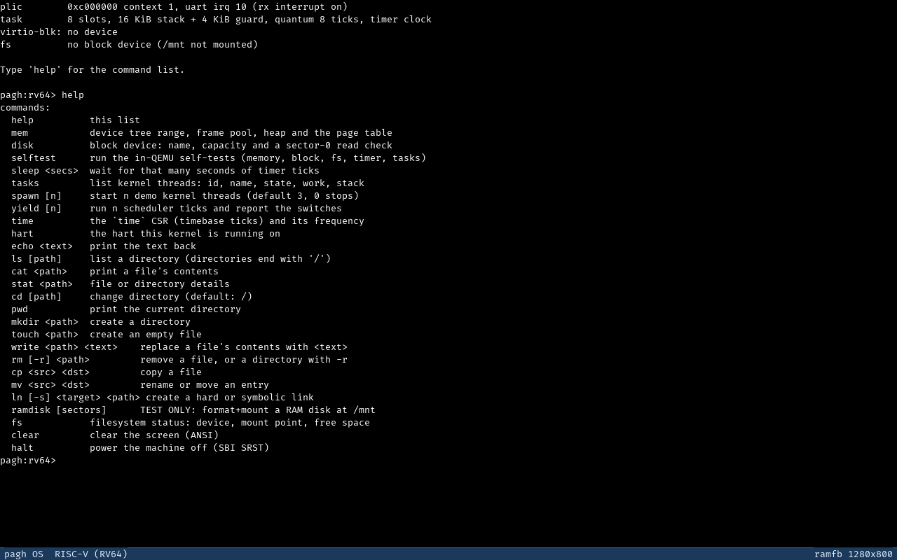
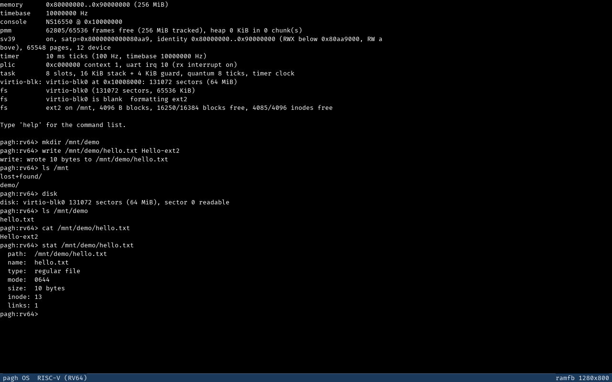
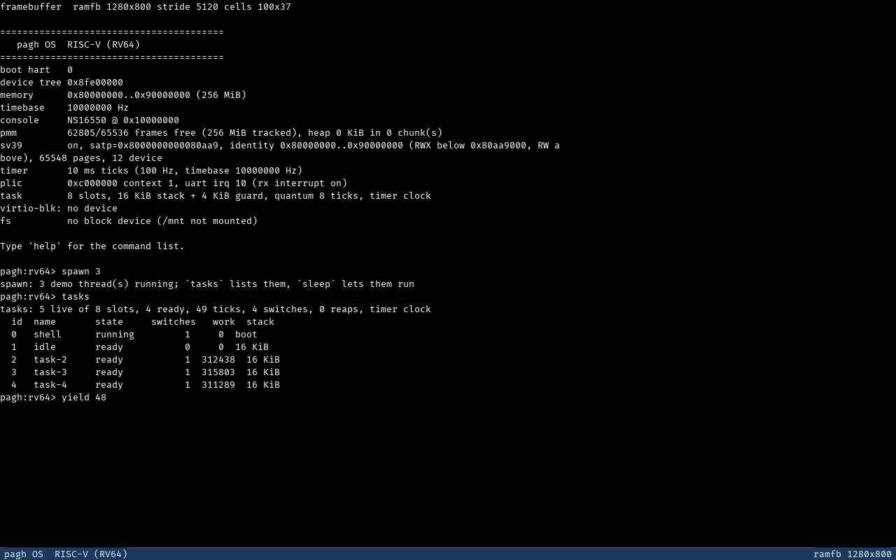

<h1 align="center">pagh-riscv</h1>

<p align="center">
  Небольшое 64-битное ядро для RISC-V (RV64) на Rust: <code>#![no_std]</code>,
  без единой внешней зависимости, загрузка через OpenSBI, запуск в QEMU.
</p>

<p align="center">
  
  
  
  
  
  
</p>

---

## English summary

`pagh-riscv` is the 64-bit RISC-V port of the [pagh](https://github.com/ccclosed/Pagh-OS)
kernel: a small `#![no_std]` Rust kernel that boots under OpenSBI on QEMU's `virt`
machine, reads the machine description from the flattened device tree, allocates
physical frames from a bitmap pool, serves `alloc` from a kernel heap that grows in
64 KiB chunks, brings up a ramfb screen with an 8×18 coverage font next to the serial
console, installs a trap vector that names its cause instead of resetting silently,
and drops into an interactive serial shell with an in-kernel self-test. **These parts
are verified on a live boot**; the timer, block devices, tasks and syscalls are
*not implemented* and are listed plainly in
[Чего нет](#чего-нет). The documentation is deliberately checkable: every claim in
[`docs/architecture.md`](docs/architecture.md) cites the file and line it comes from,
and the CI smoke test asserts the exact boot log this README shows.

```sh
cargo build                              # riscv64gc-unknown-none-elf, pinned nightly
./run.sh                                 # serial console; Ctrl-A X to leave
DISK=/tmp/pagh.img ./run.sh              # + virtio-диск: пустой образ будет отформатирован и смонтирован в /mnt
python3 tools/run.py --keys "help\n" --shot /tmp/shot.png --check-font   # screen + font
```

Docs: [architecture](docs/architecture.md) · [roadmap](docs/roadmap.md) ·
[screenshots](docs/screenshot.md) · [contributing](CONTRIBUTING.md) ·
[agents](AGENTS.md) · [crate map](src/README.md).

---

## Скриншот



Диск M5: virtio-mmio-устройство найдено через DTB, пустой образ отформатирован,
ext2 смонтирован в `/mnt`; `ls`/`cat`/`stat` работают, `disk` показывает ёмкость и
живую проверку сектора 0.



Планировщик M6a: `spawn 3` завёл три потока, `tasks` показывает снимок таблицы
(id, имя, состояние, переключения, счётчик работы, стек), `yield 48` прогнал тики
и переключения; `idle` держит hart в `wfi`, счётчики демо-потоков растут и без
единого `yield`, потому что тик таймера вытесняет их из trap-контекста.



Это не макет и не рендер на хосте: кадр нарисован самим ядром в теневом буфере и
отдан устройству `ramfb`, а снят из работающего QEMU через `screendump`. Команда
воспроизведения — та же, что проверяет пиксели:

```sh
python3 tools/run.py --keys "help\n" --shot docs/shell.png --check-font --scan-all
```

`--check-font` сверяет каждый символ на экране с `assets/font8x18.bin` (ассет
шрифта 8×18) и падает на одном отличающемся пикселе; в этом снимке проверены все
6880 клеток — ни одна не содержит пикселей вне ассета. Внизу — статус-бар
(`pagh OS  RISC-V (RV64)` … `ramfb 1280x800`).

Серийный лог одного прогона smoke-драйвера в режиме `--ramfb` (сокращён только лог
OpenSBI перед первой строкой ядра). Те же строки в том же порядке проверяет CI:

```text
framebuffer  ramfb 1280x800 stride 5120 cells 100x37

========================================
   pagh OS — RISC-V (RV64)
========================================
boot hart   0
device tree 0x8fe00000
memory      0x80000000..0x90000000 (256 MiB)
timebase    10000000 Hz
console     NS16550 @ 0x10000000
pmm         62934/65536 frames free (256 MiB tracked), heap 0 KiB in 0 chunk(s)

Type 'help' for the command list.

pagh:rv64> mem
memory 0x80000000..0x90000000 (256 MiB)
pmm    62802 free of 65536 frames (256 MiB), pool 0x80000000..0x90000000
heap   0 B used, 0 B mapped from the pool in 0 chunk(s) of 64 KiB
sv39   on  satp=0x8000000000080a28, root 0x80a28000, identity 0x80000000..0x90000000 (RWX below 0x80a28000, RW above), 65537 pages, 1 device
pagh:rv64> hart
hart 0
pagh:rv64> time
time 3950155 ticks (~0 s at 10000000 Hz)
pagh:rv64> echo smoke ok
smoke ok
pagh:rv64> nosuchcmd
nosuchcmd: unknown command (try 'help')
pagh:rv64> help
commands:
  help          this list
  mem           device tree range, frame pool, heap and the page table
  selftest      run the in-QEMU memory self-tests
  time          the `time` CSR (timebase ticks) and its frequency
  hart          the hart this kernel is running on
  echo <text>   print the text back
  clear         clear the screen (ANSI)
  halt          power the machine off (SBI SRST)
pagh:rv64> halt
halt: powering off
```

Проверки памяти запускаются из шелла (`selftest`) и печатают вердикт построчно —
это фрагмент другого прогона, той же сборки:

```text
pagh:rv64> selftest
[selftest] free frames before: 62802 of 65536
SELFTEST frames-roundtrip PASS
SELFTEST frame-pattern PASS
SELFTEST sv39-map-roundtrip PASS
SELFTEST sv39-translate PASS
[selftest] heap: 8256 B in use, 65536 B mapped, 1 chunk(s)
SELFTEST heap-vec PASS
heap: double free of 0x80a73090 ignored
heap: refusing to free 0x802302b8: not a heap block
SELFTEST heap-defenses PASS
SELFTEST SUMMARY: 6/6 passed
[selftest] PMM hygiene: free frames 62802 -> 62802
```

Числа кадров зависят от размера ядра и от `-m`; проверяется не они, а то, что
строка есть, что все проверки PASS и что ledger до и после совпадает.

---

## Что работает сегодня

Статус — по коду в дереве, а не по замыслу. «Готово» подтверждено живым запуском.

| Подсистема | Статус | Что именно есть | Где |
|---|---|---|---|
| Загрузка | готово | `_start` ставит стек и вызывает `kmain(a0, a1)`; OpenSBI запускает ровно один hart (id не обязательно 0), остальные держит остановленными | `src/arch/riscv64/boot.rs` |
| Модель привилегий | готово | S-mode под OpenSBI, M-mode не трогаем; выключение через SBI SRST | `src/arch/riscv64/sbi.rs` |
| Device tree | частично | только `/memory` (`reg`) и `/cpus:timebase-frequency`; ошибка разбора фатальна | `src/fdt.rs` |
| Ловушки | частично | `stvec` → `trap_entry` → диспетчер: называет причину и останавливает hart; восстановления после исключения нет | `src/arch/riscv64/traps.rs` |
| Консоль | готово | NS16550 по `0x1000_0000`, 8N1; приём — по прерыванию PLIC в кольцевой буфер (polled-путь остаётся запасным), передача по-прежнему polled; один текстовый поток — два стока | `src/drivers/uart.rs`, `src/console.rs` |
| Экран | готово | ramfb 1280×800, stride 5120, сетка 100×37, шрифт покрытия 8×18, статус-бар; кадр отдаётся на каждый `kprint!` | `src/drivers/{fw_cfg,ramfb,framebuffer}.rs` |
| Шелл | готово | редактор строки (строки длиннее 128 байт отклоняются целиком, а не обрезаются), `wfi`-ожидание ввода; команды памяти/диска/ФС, `sleep`, `time`, `halt` (полный список — в таблице ниже) | `src/shell.rs` |
| Физическая память (PMM) | готово | битовая карта 4 KiB-кадров окна 8 GiB (покрывает QEMU `virt` с RAM выше 4 GiB), `set = свободен`, выделение одиночное и непрерывным блоком | `src/memory/pmm.rs` |
| Куча ядра, `alloc` | готово | `#[global_allocator]` поверх PMM-кадров: чанки по 64 KiB, free-list, целиком свободный чанк возвращается в PMM; `Vec` проверен `selftest` | `src/memory/{heap,selftest}.rs` |
| Страницы (Sv39) | готово (ядро) | identity-карта 4 KiB-страниц, `satp` включён: `[RAM base, __kernel_end)` RWX, выше — RW **без X**, страница UART RW; таблицы берутся из PMM, пустые возвращаются при `unmap`. Пользовательских адресных пространств нет | `src/memory/paging.rs`, `src/arch/riscv64/mmu.rs` |
| Таймер | готово | тик 100 Гц через SBI TIME: абсолютный дедлайн (+10 мс на прерывание, без накопления дрейфа), `sie.STIE`, `sleep`/`uptime` в тиках; холостой цикл — `wfi` | `src/arch/riscv64/timer.rs` |
| Прерывания / PLIC | готово | PLIC из DTB (`riscv,plic0`), контекст S-mode, UART source из DTB (10 на QEMU `virt`), claim/complete, счётчики и `overrun`; диспетчер различает timer/external и возвращается через `sret` | `src/arch/riscv64/plic.rs`, `src/arch/riscv64/traps.rs` |
| Блочное устройство | готово | virtio-mmio (modern virtio 1.x, version 2), polled: окна транспорта находятся через DTB, read/write/flush, опрос завершения с ограничением и FAILED после таймаута; `-global virtio-mmio.force-legacy=false` обязателен (иначе QEMU даёт legacy-транспорт) | `src/drivers/block.rs`, `src/drivers/virtio_mmio.rs` |
| Файловая система (ext2) | готово | чтение/запись файлов (direct + single/double indirect), truncate, каталоги, create/unlink/mkdir/rmdir/rename, симлинки; совместимо с образом хостового `mkfs.ext2 -t ext2`; форматируется только пустое устройство (MBR/GPT/чужие данные — отказ с причиной); журнала/WAL нет | `src/fs/ext2/`, `src/fs/format_policy.rs` |
| VFS | готово | `VfsNode`, синтетический корень, монтирование в `/mnt`, два примитива разрешения путей (`lookup_path` без последней симлинки / `walk` с переходом и бюджетом) | `src/vfs/mod.rs` |
| Планировщик, потоки ядра (M6a) | готово | контекстный switch (callee-saved ABI), до 8 потоков, round-robin, квант 8 тиков, стек 16 KiB + guard из PMM, вытеснение тиком таймера из trap-контекста, `tasks`/`spawn`/`yield`; exit возвращает кадры | `src/arch/riscv64/switch.rs`, `src/task/` |
| User mode, syscalls, ELF (M6b) | **нет** | — | M6b, план: U-бит в карте, `sret` в U-mode, `ecall`-диспетчер, ELF-загрузчик |
| Сеть, пакеты, apt | **нет** | есть в [x86-репозитории](https://github.com/ccclosed/Pagh-OS), сюда не портируется | — |
| Тесты | частично | host-тестов нет; in-QEMU `selftest` — 7 памяти + 3 блочного слоя + 11 ext2/VFS + 4 прерываний/таймера + 5 планировщика (идемпотентность по ledger'у свободных кадров), QEMU-smoke в четырёх режимах (serial, ramfb, диск-fresh, диск-existing) и проверка пикселей `tools/font_check.py` | `src/memory/selftest.rs`, `src/drivers/selftest.rs`, `src/fs/selftest.rs`, `src/arch/riscv64/selftest.rs`, `src/task/selftest.rs`, `.github/smoke.py`, `tools/` |
| CI | готово | `fmt`, debug/release build, QEMU-smoke (serial, ramfb, и приёмка M5: пустой диск → формат/монтирование/запись, повторная загрузка того же образа читает файл) | `.github/workflows/ci.yml` |

---

## Быстрый старт

```sh
rustup target add riscv64gc-unknown-none-elf   # nightly запинен в rust-toolchain.toml
cargo build                                    # debug-ядро, линкуется linker.ld
./run.sh                                       # QEMU virt + OpenSBI, serial в терминал
```

`run.sh` — канонический способ запуска (Linux/QEMU). Он собирает ядро и выполняет
по сути это:

```sh
qemu-system-riscv64 -machine virt -m 256M -device ramfb \
                    -kernel target/riscv64gc-unknown-none-elf/debug/pagh \
                    -display none -serial mon:stdio -no-reboot
```

`-device ramfb` — это и есть экран: у машины `virt` нет VGA, а ядро находит
устройство через `fw_cfg`. По умолчанию поверхность рисуется **off-screen**
(`-display none`), поэтому `screendump` и `tools/run.py` работают без графической
сессии; `./run.sh --window` показывает то же самое окном QEMU. Если запустить QEMU
без `-device ramfb`, ядро остаётся serial-консолью и честно печатает
`framebuffer  ramfb: no such fw_cfg item — serial console only`.

| Аргумент / переменная | По умолчанию | Смысл |
|---|---|---|
| `--window` | выключено | показать экран окном QEMU (`-display gtk`) |
| `--headless` | включено | явная форма поведения по умолчанию: рисовать off-screen |
| `PROFILE` | `debug` | `release` — собрать и запустить release-ядро |
| `MEMORY` | `256M` | объём RAM у `virt` |
| `BIOS` | — (QEMU `-bios default`) | внешняя прошивка, например `BIOS=/path/opensbi.bin` |
| `DISK` | — | образ virtio-mmio диска; отсутствующий создаётся пустым (64 MiB), пустой форматируется ядром и монтируется в `/mnt` |

Выход из QEMU — `Ctrl-A`, затем `X`. Изнутри гостя: команда `halt` (SBI SRST,
машина действительно выключается, QEMU завершается с кодом 0).

Автоматические проверки «ядро живо» — те же, что в CI:

```sh
cargo build
python3 .github/smoke.py target/riscv64gc-unknown-none-elf/debug/pagh           # только serial
python3 .github/smoke.py target/riscv64gc-unknown-none-elf/debug/pagh --ramfb   # + экран
python3 tools/run.py --keys "help\n" --shot /tmp/shot.png --check-font          # пиксели против ассета
```

### Как управлять шеллом

Промпт `pagh:rv64> `, строка до 128 байт (более длинная отвергается целиком),
backspace работает, всё остальное — команды:

| Команда | Что делает |
|---|---|
| `help` | список команд |
| `mem` | память из device tree **и** статистика PMM и кучи (свободно/всего кадров, диапазон пула, байты кучи) |
| `selftest` | in-QEMU self-tests: 7 проверок памяти, 3 блочного слоя, 11 ext2/VFS; печатает ledger свободных кадров до и после прогона |
| `disk` | блочное устройство: имя, ёмкость, живая проверка чтения сектора 0 |
| `ls [path]` | листинг каталога (каталоги с `/`) |
| `cat <path>` | содержимое файла |
| `stat <path>` | путь, имя, тип, режим, размер, inode, ссылки |
| `cd [path]` / `pwd` | текущий каталог (лексическое склеивание, без `..` из монтирования) |
| `mkdir <path>` / `touch <path>` | создать каталог / пустой файл |
| `write <path> <text>` | заменить содержимое файла текстом |
| `rm [-r] <path>` | удалить файл, каталог — с `-r` |
| `cp <src> <dst>` / `mv <src> <dst>` | копировать / переименовать |
| `ln [-s] <target> <path>` | жёсткая или символическая ссылка |
| `ramdisk [sectors]` | **только для тестов**: отформатировать RAM-диск и смонтировать его в `/mnt` |
| `time` | два счётчика: CSR `time` (аппаратный) и тики ядра; uptime, число прерываний таймера, статистика PLIC/UART |
| `hart` | id hart'а, на котором работает ядро |
| `echo <text>` | печатает текст (слова через один пробел) |
| `clear` | очистка экрана ANSI-последовательностью (чистит и экран, и терминал) |
| `sleep <secs>` | ждать столько секунд тиков (`wfi`, не спин) |
| `tasks` | потоки ядра: id, имя, состояние, переключения, работа, стек |
| `spawn [n]` | запустить n демо-потоков (по умолчанию 3; 0 — остановить) |
| `yield [n]` | прогнать n тиков планировщика и показать число переключений |
| `halt` | выключение машины через SBI SRST |

Истории, автодополнения и стрелок нет — это следующий уровень шелла, а не
забытая деталь.

---

## Архитектура

Подробно, с ссылками на файлы и строки — [`docs/architecture.md`](docs/architecture.md).
Здесь — короткая версия.

**Путь загрузки.** OpenSBI (M-mode) передаёт управление в S-mode на `_start` с
`a0` = hart id и `a1` = адрес DTB, без стека и с выключенными прерываниями.
Дальше фазы идут строго по порядку, каждая опирается на предыдущую:

| # | Фаза | Код |
|---|---|---|
| 1 | `_start`: OpenSBI запускает ровно один hart (любого id); стек и `kmain` | `src/arch/riscv64/boot.rs` |
| 2 | стек: `sp = __stack_top`, 64 KiB в `.bss`, выравнивание 16 | `src/arch/riscv64/boot.rs` |
| 3 | захват hart id в `BOOT_HART_ID` (пока он в `a0`) | `src/arch/riscv64/boot.rs` |
| 4 | `call kmain(a0, a1)` | `src/arch/riscv64/boot.rs` |
| 5 | консоль: `uart::init()` + попытка поднять экран (`console::init` → `framebuffer::init`) | `src/main.rs`, `src/console.rs` |
| 6 | баннер: hart, адрес DTB | `src/main.rs` |
| 7 | разбор DTB; ошибка → печать и остановка, без угадывания | `src/main.rs`, `src/fdt.rs` |
| 8 | память и timebase из DTB — в лог | `src/main.rs` |
| 9 | PMM: пул кадров по `/memory` минус образ ядра, стек и блоб DTB | `src/main.rs`, `src/memory/` |
| 10 | `traps::init()`: `stvec` + `sstatus.SIE` — до всего, что может сбойнуть | `src/main.rs`, `src/arch/riscv64/traps.rs` |
| 11 | `shell::run(tree)` — цикл консоли, не возвращается | `src/main.rs`, `src/shell.rs` |

**Привилегии.** Ядро живёт в S-mode; M-mode принадлежит прошивке, и обращаться
туда можно только через SBI (`ecall`) — именно так работает `halt`. M-mode CSR
из S-mode недоступны физически: `csrr …, mhartid` — это illegal instruction, и
ядро узнало это на своём опыте (см. `docs/architecture.md`, раздел 2). `satp`
включает Sv39 с identity-картой (страницы 4 KiB, без user-бита); U-mode нет.

**Устройства.** Единственное описание машины — device tree: ядро читает из него
память и частоту timebase, отказываясь угадывать при ошибке разбора. Адреса UART
и `fw_cfg` продублированы константами только потому, что консоль нужна раньше
разбора (у обоих в коде написано, почему, и оба падают громко, а не молча).

**Память.** Ядро линкуется на `0x8020_0000` (`linker.ld`), `.bss` — 8 МиБ:
две поверхности экрана (тень и scanout), битовая карта PMM, стек 64 KiB и
статики; `__kernel_end` выровнен на 4 KiB. `.bss` не обнуляется кодом ядра:
обнуляет ELF-загрузчик QEMU (NOBITS-сегмент) — и это существенно, потому что
полярность карты PMM («бит установлен = кадр свободен») держится именно на нулях.
Полная карта — в `docs/architecture.md`, раздел 6.

**Ловушки.** `trap_entry` сохраняет 33 регистра в кадр на 264 байта; смещения —
это ABI, они совпадают с порядком `sd` в ассемблере. Исключение печатает
`[EXC] <имя> (scause=…, stval=…, sepc=…)` и останавливает hart; прерывание
возвращается через `sret`. Паники в обработчике нет и быть не должно: при
`panic = "abort"` она убила бы машину, оставив кадр единственной уликой.

---

## Дорожная карта

| # | Майлстоун | Статус |
|---|---|---|
| M1 | Загрузка под OpenSBI, DTB, ловушки, UART-консоль и шелл | **готов** |
| M2 | Физический аллокатор кадров, Sv39, куча ядра, `alloc` | **готов** (identity Sv39 с W^X, куча и `alloc`; page-fault ловушки — задел M6) |
| M3 | Таймер через SBI, PLIC, консоль на прерываниях | план |
| M4 | ramfb + шрифт покрытия Fira Code, съёмка скриншотов | **готов** (экран, шрифт и снимок проверены) |
| M5 | virtio-mmio блочное устройство, ext2, VFS | **готов** (virtio-mmio, ext2 rw + формат пустого диска, VFS, шелл-команды; журнала нет) |
| M6 | Задачи, syscalls, Linux-compat-слой из x86-ветки | M6a (планировщик и потоки) — **готов**; M6b (user mode, syscalls, ELF) — план |

Что считается «сделано» для каждого майлстоуна и что в него не входит —
[`docs/roadmap.md`](docs/roadmap.md).

---

## Чего нет

Этот список — часть документации, а не извинение. Если подсистемы здесь нет,
значит её нет в коде.

* **Нет пользовательских адресных пространств.** Sv39 включён, но карта одна и
  только для ядра: identity, 4 KiB-страницы, без суперстраниц, без user-бита,
  `satp.ASID = 0`; `map`/`unmap`/`translate` есть, VMM/mprotect/разделяемых
  страниц нет. Куча и `alloc`
  уже есть: `#[global_allocator]` поверх PMM-кадров (`src/memory/heap.rs`), так что
  `Vec`, `String` и `Box` доступны и проверены `selftest`; буферы шелла пока
  фиксированные. `Cargo.toml` не содержит ни одной зависимости.
* **Нет таймера и прерываний.** `sie` не включается ни для одного источника;
  `time` просто читает CSR. Ветка таймера в диспетчере — пустой `return`.
* **Нет PLIC.** Внешнее прерывание печатает «not routed yet».
* **Нет восстановления после исключения.** Любой сбой в ядре — печать и
  остановка hart: продолжить безопасно нельзя, состояние осталось на месте.
* **Экран есть только там, где есть устройство `ramfb`.** `run.sh` передаёт
  `-device ramfb`, поэтому «из коробки» экран есть; QEMU без этого флага (и любая
  другая машина) — это serial-консоль без экрана, и ядро говорит об этом в логе.
  Шрифт — офлайн-растеризованный ассет `assets/font8x18.bin`; TrueType-парсера в
  ядре нет, глифов вне ASCII тоже.
* **Нет диска, ФС, VFS, задач, syscall'ов, userland, сети.** Ни файлов, ни
  модулей.
* **Нет host-тестов.** Логика ядра тестами не покрыта: `selftest` проверяет только
  память (кадры, шаблон в кадре, куча), остальное — QEMU-smoke в двух режимах
  (serial и ramfb) и сверка пикселей `tools/font_check.py`. Чистая логика
  (`src/fdt.rs`) не покрыта ничем.
* **Нет SMP.** Работает ровно один hart; остальные запаркованы в `_start`.
* **Нет поддержки реального железа.** Адреса UART и `fw_cfg` захардкожены,
  поддерживается только QEMU `virt` с `-kernel` + OpenSBI.
* **Сборка даёт предупреждения** (неиспользуемые CSR-хелперы, мёртвый код,
  приведение функции к числу в `traps.rs`); CI их не гейтит.
* **LICENSE-файла нет**, хотя `Cargo.toml` объявляет MIT.

Отдельно, как требование к следующему шагу: `uart::put_byte` берёт спинлок с
включёнными прерываниями (`src/drivers/uart.rs:67-73`). Пока `sie` = 0, это
безопасно; как только появится первый источник прерываний, критическую секцию
нужно обернуть в `csr::without_interrupts`, иначе обработчик, печатающий в
консоль, встанет на локе, который держит прерванный контекст. Разбор —
`docs/architecture.md`, раздел 12.1.

---

## Устройство репозитория

```text
src/main.rs                    boot-фазы по порядку, баннер, panic_handler
src/arch/riscv64/boot.rs       _start: стек, парковка hart'ов, вызов kmain
src/arch/riscv64/csr.rs        типизированный доступ к CSR
src/arch/riscv64/traps.rs      trap_entry, кадр на 264 байта, диспетчер
src/arch/riscv64/sbi.rs        ecall в M-mode (SRST)
src/arch/riscv64/mmu.rs        примитивы Sv39 (PTE, PageTable, satp, sfence)
src/memory/paging.rs           identity-карта ядра, map/unmap/translate, satp
src/fdt.rs                     минимальный читатель flattened device tree
src/memory/{mod,pmm}.rs        пул физических кадров (битовая карта 4 KiB)
src/memory/heap.rs             куча: free-list поверх чанков по 64 KiB
src/memory/selftest.rs         in-QEMU self-tests памяти (selftest)
src/memory/README.md           дизайн памяти: кадры, куча, чего нет
src/drivers/uart.rs            NS16550, polled
src/drivers/fw_cfg.rs          QEMU fw_cfg: селектор/данные + DMA
src/drivers/ramfb.rs           конфигурация устройства ramfb
src/drivers/framebuffer.rs     текстовый экран: тень, шрифт, статус-бар
src/console.rs                 kprint!/kprintln!: UART + экран
src/shell.rs                   редактор строки и команды
src/sync.rs                    один нереентерабельный спинлок
docs/architecture.md           загрузка, кадр ловушки, привилегии, карта памяти
docs/roadmap.md                майлстоуны M1–M6 и их критерии
docs/shell.png                 снимок экрана из работающего QEMU
assets/font8x18.bin            шрифт покрытия 8×18 (8 бит на пиксель)
tools/run.py                   запуск + screendump + проверка шрифта
tools/gen_font.py              офлайн-растеризация шрифта в ассет
tools/font_check.py            сверка пикселей снимка с ассетом
.github/smoke.py               QEMU-smoke: serial и ramfb режимы
.github/workflows/ci.yml       fmt + debug/release build + smoke
run.sh                         единственный лаунчер (QEMU virt + OpenSBI)
linker.ld                      один сегмент, точка входа _start, 0x8020_0000
```

Правило репозитория: **каждая подсистема документирует себя** — у `src/<подсистема>/`
должен быть README, совпадающий с кодом (`src/README.md`, `src/arch/README.md`,
`src/drivers/README.md`, `src/memory/README.md`). Изменение поведения без изменения
документации здесь считается ошибкой.

## Качество и CI

| Гейт | Команда |
|---|---|
| Форматирование | `cargo fmt --all -- --check` |
| Debug-сборка | `cargo build --locked` |
| Release-сборка | `cargo build --locked --release` |
| Дымовой тест: serial | `python3 .github/smoke.py target/riscv64gc-unknown-none-elf/debug/pagh` |
| Дымовой тест: экран | `python3 .github/smoke.py target/riscv64gc-unknown-none-elf/debug/pagh --ramfb` |

Всё это выполняется в CI (`.github/workflows/ci.yml`) на запиненном nightly из
`rust-toolchain.toml`: `fmt` и обе сборки — отдельными job'ами, два режима smoke —
двумя шагами одного job'а. Режим `--ramfb` добавляет
`-device ramfb`, так что поднятие экрана проверяется без дисплея. Smoke-тест ждёт
баннер (UART очищает FIFO при инициализации, поэтому команды, отправленные
раньше, теряются), шлёт `mem`, `hart`, `time`, `echo`, неизвестную команду,
`help` и `halt`, и требует, чтобы после `halt` QEMU завершился с кодом 0.

## Родословная

Второе ядро в семье: x86-64-версия — [ccclosed/Pagh-OS](https://github.com/ccclosed/Pagh-OS)
(Limine/UEFI, ext2 + WAL, свой TCP/IP, apt, framebuffer-GUI, Linux-compat
userland). Идея та же — маленькое `#![no_std]`-ядро, которое сразу даёт
работающую консоль, — но машина описывает себя device tree вместо firmware-таблиц,
а весь код здесь написан заново под RV64. Часть майлстоунов (M4–M6) — это
сознательное повторение x86-пути на новой архитектуре.

Ядро написано ИИ под надзором человека. Лицензия — MIT (`Cargo.toml`).